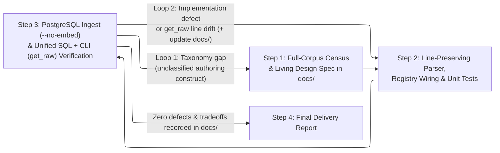

# Framework Parser Design, Implementation & Quality Reinforcement Workflow

This skill governs the closed-loop engineering workflow for building and hardening a dedicated framework documentation parser (`BaseCodingParser`) in the Coding RAG system, coupling a living design specification in `docs/` with a two-loop verification gate over real PostgreSQL records and MCP CLI tools.

---

## Architectural & Data Invariants (Closed Contracts)

Every framework parser created or modified by this workflow must satisfy all of the following system contracts:

1. **Base Class & Registry Contract ([`src/rag_eval/ingestion/registry.py`](file:///home/hoang/python/rag-nlp/src/rag_eval/ingestion/registry.py#L21-L105), [`AGENTS.md`](file:///home/hoang/python/rag-nlp/AGENTS.md#L6))**:
   - Subclass [`BaseCodingParser`](file:///home/hoang/python/rag-nlp/src/rag_eval/ingestion/registry.py#L21-L65) in `src/rag_eval/ingestion/parsers/<framework>.py`, defining `name: str` and `framework_prefix: str` (the root `ltree` namespace segment, e.g., `"nodejs"`, `"nextjs"`).
   - Implement `can_handle(self, file_path: Path, raw_text: str = "") -> bool` to identify the target framework's files deterministically without generic fallbacks.
   - Implement `parse(self, file_path: Path, doc_slug: str | None = None, corpus_root: Path | None = None) -> ParsedDocumentDraft` using `self.resolve_doc_slug(resolved_path, doc_slug=doc_slug, corpus_root=corpus_root)`.
   - Always return `edges=[]` in `ParsedDocumentDraft`: the parser is solely responsible for hierarchical `chunks` decomposition and line-span preservation, while knowledge graph edges are managed via `graph_curate_edges`.
   - Register the parser instance in both [`src/rag_eval/ingestion/parsers/__init__.py`](file:///home/hoang/python/rag-nlp/src/rag_eval/ingestion/parsers/__init__.py) and [`DirectIngestionCoordinator.__init__`](file:///home/hoang/python/rag-nlp/src/rag_eval/ingestion/pipeline.py#L47-L48).

2. **Chunk Data Integrity Contract ([`003_chunks.sql`](file:///home/hoang/python/rag-nlp/src/rag_eval/db/sql/003_chunks.sql#L1-L15), [`schemas.py`](file:///home/hoang/python/rag-nlp/src/rag_eval/schemas.py#L155-L213), [`chunks.py`](file:///home/hoang/python/rag-nlp/src/rag_eval/db/repositories/chunks.py#L454-L484))**:
   - `path`: A valid, document-unique `ltree` path (`^[A-Za-z0-9_]+(\.[A-Za-z0-9_]+)*$`) rooted at `doc_slug` that preserves true parent-child hierarchy for `CHILDREN`, `SIBLINGS`, `SUBTREE`, and `PARENT_CHAIN` queries.
   - `start_line` and `end_line`: 1-indexed integers (`end_line >= start_line >= 1`) matching the exact line numbers in `documents.raw_text.splitlines()`.
   - `contextualized_text`: Synthesized strictly as `f"[{' > '.join(breadcrumbs)}]\n{verbatim_text}"` so [`split_context_and_text`](file:///home/hoang/python/rag-nlp/src/rag_eval/schemas.py#L417-L436) extracts the ancestor breadcrumb cleanly.
   - `metadata`: Must include `"ancestor_titles": list[str]` (ordered titles from the document root to the section for `PARENT_CHAIN` reconstruction), `"node_type"`, `"heading"`, `"framework"`, `"has_code"`, and `"has_table"`.

---

## Sequential Execution Workflow

Execute Steps 1 through 4 autonomously end-to-end, pausing to ask the user only when an ambiguity in the corpus cannot be resolved from the documentation syntax itself.

### Step 1: Quantitative Corpus Census & Living Design Specification

Census 100% of the files in `data/<framework>/` before writing parser code to map every recurring AST construct to the semantic role the authors gave it—structural container, independent reference unit, shared-body signature, or internal sub-section of an enclosing unit—and record this taxonomy in `docs/<framework>_doc_structure_and_parser_design.md` so that every chunk-splitting and tree-pruning condition derives exclusively from those syntactic markers and parent-child AST roles, emitting one cohesive chunk per independent reference unit with its internal sub-sections intact regardless of heading depth or character count.

*Completion criterion*: `docs/<framework>_doc_structure_and_parser_design.md` exists on disk containing full-corpus quantitative counts across `data/<framework>/` (file count, heading-level distribution, non-prose syntax layers, and exact counts and syntactic rules distinguishing containers, independent units, shared-body signatures, and internal sub-sections) along with the parser architecture derived from those rules.

---

### Step 2: Line-Preserving Parser Implementation, Registry Wiring & Unit Tests

When preprocessing text before AST parsing, replace every stripped frontmatter block, comment directive, or standalone anchor outside code fences in place with its synthesized text and the exact same number of newline characters (`assert len(clean_text.splitlines()) == len(raw_content.splitlines())`), so that non-prose tokens vanish from neighboring section bodies while every AST token's 1-indexed `[start_line, end_line]` maps 1:1 to `documents.raw_text` under `get_raw`.

Wire the parser into [`src/rag_eval/ingestion/parsers/__init__.py`](file:///home/hoang/python/rag-nlp/src/rag_eval/ingestion/parsers/__init__.py) and [`src/rag_eval/ingestion/pipeline.py`](file:///home/hoang/python/rag-nlp/src/rag_eval/ingestion/pipeline.py), and write structural unit tests in `tests/unit/test_<framework>_parser.py` using synthetic structural stubs as required by [`AGENTS.md`](file:///home/hoang/python/rag-nlp/AGENTS.md#L28-L31).

*Completion criterion*: `uv run scripts/check.py` and `uv run pytest` both exit with code 0 and zero type, lint, or test failures.

---

### Step 3: Unified PostgreSQL + CLI Verification Gate & Two-Loop Accretion

Ingest all files in `data/<framework>/` into PostgreSQL with `--no-embed` (`compute_embeddings=False`), then execute both SQL audits and headless CLI sensor checks (`uv run rag-eval tool hierarchical_navigate`, `hybrid_search`, and `get_raw`).

In each verification pass after ingesting `data/<framework>/` into PostgreSQL with `--no-embed`, audit the live records using both SQL queries across all four `chunks` schema dimensions (`verbatim_text` length extremes and unstripped syntax, `path` collision suffixes and parent-child `ltree` continuity, `metadata` ancestry fields, and `[start_line, end_line]` spans) and CLI tool calls (`hierarchical_navigate`, `hybrid_search`, and `get_raw` line-for-line slice comparison); for every anomalous chunk, trace the parser rule that produced it, the purpose that rule serves, and why it fired, then update `docs/<framework>_doc_structure_and_parser_design.md` and route by cause:
- **When** the anomaly exposes an authoring construct in the source corpus that is absent from the taxonomy in `docs/<framework>_doc_structure_and_parser_design.md` (taxonomy gap), return to Step 1 to add the construct and its syntactic rule to `docs/<framework>_doc_structure_and_parser_design.md`, then proceed to Step 2 to implement, test, re-ingest (`--no-embed`), and re-verify.
- **When** the anomaly contradicts an existing role in `docs/<framework>_doc_structure_and_parser_design.md` or drifts from `get_raw` line numbers because a parser rule's syntactic condition missed or over-matched a form in the source text (implementation defect), return to Step 2 to refine that syntactic condition and add a unit test, record the boundary rule in `docs/<framework>_doc_structure_and_parser_design.md`, re-ingest (`--no-embed`), and repeat this verification pass until zero defects remain across both SQL and CLI checks.
- **When** the anomaly reflects genuine author prose or structure under its role, and any rule change or heuristic that suppresses it would discard or distort valid chunks elsewhere in the corpus (structural tradeoff), keep the parser rule unchanged and record both the preserved tradeoff (with `file:line` evidence) and any rejected heuristic (with the valid chunks it would damage) in `docs/<framework>_doc_structure_and_parser_design.md`.

*Completion criterion*: All files in `data/<framework>/` are ingested into PostgreSQL following the final parser revision, both SQL queries and CLI calls (`hierarchical_navigate`, `hybrid_search`, and `get_raw` 1:1 line-span verification) confirm zero remaining taxonomy gaps or implementation defects, `uv run scripts/check.py` and `uv run pytest` pass, and `docs/<framework>_doc_structure_and_parser_design.md` contains every boundary refinement, rejected heuristic, and preserved structural tradeoff discovered during the loop.

---

### Step 4: Final Delivery Report

Summarize the completed ingestion and verification results for the user, pointing to `docs/<framework>_doc_structure_and_parser_design.md` and the parser implementation.

*Completion criterion*: The report delivered to the user states the total ingested documents and chunks in PostgreSQL, lists each taxonomy gap and implementation defect resolved across the verification loops, lists each preserved structural tradeoff and rejected heuristic recorded in `docs/<framework>_doc_structure_and_parser_design.md`, and shows the verified `hierarchical_navigate`, `hybrid_search`, and `get_raw` line-alignment results.
