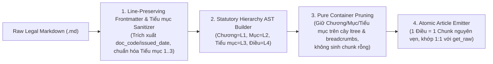

# Cấu Trúc Ngữ Nghĩa Văn Bản Pháp Luật Bảo Hiểm & Thiết Kế Parser (`BaoHiemMarkdownParser`)

Tài liệu này đúc kết kết quả khảo sát định lượng 100% kho văn bản quy phạm pháp luật về Kinh doanh bảo hiểm Việt Nam trong `data/baohiem/` (**3 văn bản trụ cột**, tổng cộng **8.426 dòng**, **657.199 ký tự**, **405 đơn vị phân cấp**) và đặc tả kiến trúc của [`BaoHiemMarkdownParser`](file:///home/hoang/python/rag-nlp/src/rag_eval/ingestion/parsers/baohiem_md.py).

---

## 1. Khảo Sát Định Lượng Toàn Cục (`data/baohiem/*.md`)

Bộ dữ liệu `data/baohiem/` bao gồm trọn vẹn chuỗi 3 tầng văn bản quy phạm pháp luật điều chỉnh lĩnh vực kinh doanh bảo hiểm tại Việt Nam (Luật của Quốc hội $\rightarrow$ Nghị định của Chính phủ $\rightarrow$ Thông tư hướng dẫn của Bộ Tài chính), được trích xuất nguyên văn từ Cơ sở dữ liệu Quốc gia về Văn bản pháp luật (`vbpl.vn`):

| Tệp văn bản | Số hiệu | Cấp ban hành | Số dòng | Số ký tự | `Chương` | `Mục` | `Tiểu mục` | `Điều` | `Khoản` (`1.`, `2.`) | `Điểm` (`a)`, `b)`, `đ)`) |
| :--- | :--- | :--- | ---: | ---: | ---: | ---: | ---: | ---: | ---: | ---: |
| [`luat_kinh_doanh_bao_hiem_08_2022_qh15.md`](file:///home/hoang/python/rag-nlp/data/baohiem/luat_kinh_doanh_bao_hiem_08_2022_qh15.md) | `08/2022/QH15` | Quốc hội | `2.466` | `197.889` | `7` | `16` | `0` | `157` | `514` | `500` |
| [`nghi_dinh_46_2023_nd_cp.md`](file:///home/hoang/python/rag-nlp/data/baohiem/nghi_dinh_46_2023_nd_cp.md) | `46/2023/NĐ-CP` | Chính phủ | `2.826` | `270.918` | `8` | `14` | `3` | `123` | `546` | `649` |
| [`thong_tu_67_2023_tt_btc.md`](file:///home/hoang/python/rag-nlp/data/baohiem/thong_tu_67_2023_tt_btc.md) | `67/2023/TT-BTC` (`44/2026/VBHN-TT-BTC`) | Bộ Tài chính | `3.134` | `188.392` | `7` | `8` | `0` | `62` | `256` | `303` |
| **Tổng cộng** | **3 văn bản** | **3 cấp** | **`8.426`** | **`657.199`** | **`22`** | **`38`** | **`3`** | **`342`** | **`1.316`** | **`1.452`** |

### 1.1. Phân bố cấp độ Heading và Đơn vị Cấu trúc Pháp lý

Khác với tài liệu kỹ thuật thông thường, văn bản quy phạm pháp luật Việt Nam tuân thủ nghiêm ngặt bố cục hình thức của *Luật Ban hành văn bản quy phạm pháp luật* (`Chương` $\rightarrow$ `Mục` $\rightarrow$ `Tiểu mục` $\rightarrow$ `Điều` $\rightarrow$ `Khoản` $\rightarrow$ `Điểm`):

| Cấp độ trong tài liệu | Dấu hiệu cú pháp trong Corpus | Số lượng | Tỷ lệ | Vai trò ngữ nghĩa trong AST | Có văn xuôi riêng ngoài tiêu đề? |
| :--- | :--- | ---: | ---: | :--- | :--- |
| **Văn bản (`H1`)** | `# <Tên văn bản>` + YAML Frontmatter | `3` | `0.74%` | Nút gốc tài liệu (`root_section`, `level = 0`) | `0 / 3` (vào thẳng `Chương I`) |
| **Chương (`H2`)** | `## Chương <Số La Mã>: <Tên chương>` | `22` | `5.43%` | Nút khung phân loại cấp 1 (`sem_level = 1`, `CHAPTER`) | `0 / 22` (100% là container thuần cấu trúc) |
| **Mục (`H3`)** | `### Mục <Số>: <Tên mục>` | `38` | `9.38%` | Nút khung phân loại cấp 2 (`sem_level = 2`, `SECTION`) | `0 / 38` (100% là container thuần cấu trúc) |
| **Tiểu mục** | `Tiểu mục <Số>` + dòng tiêu đề IN HOA | `3` | `0.74%` | Nút khung phân loại cấp 3 (`sem_level = 3`, `SUBSECTION`) | `0 / 3` (100% là container thuần cấu trúc) |
| **Điều (`H4`)** | `#### Điều <Số>. <Tên điều>` | `342` | `84.44%` | Đơn vị quy phạm độc lập (`sem_level = 4`, `ARTICLE`) | `342 / 342` (100% có thân quy định) |
| **Tổng cộng** | | **`408`** | **`100%`** | **`66` Container + `342` Đơn vị độc lập** | **`342` Chunks (`1 Điều = 1 Chunk`)** |

### 1.2. Phân bố độ dài của 342 `Điều` trên toàn bộ Corpus

| Văn bản | Số `Điều` | Độ dài nhỏ nhất (ký tự / dòng) | Trung vị (ký tự / dòng) | Trung bình (ký tự) | Độ dài lớn nhất (ký tự / dòng) |
| :--- | ---: | ---: | ---: | ---: | ---: |
| `08/2022/QH15` | `157` | `152` chars (`5` dòng — `Điều 62`) | `982` chars (`12` dòng) | `1.250` chars | `8.319` chars (`61` dòng — `Điều 4. Giải thích từ ngữ`) |
| `46/2023/NĐ-CP` | `123` | `147` chars (`7` dòng — `Điều 5`) | `1.784` chars (`18` dòng) | `2.186` chars | `8.001` chars (`69` dòng — `Điều 21. Thay đổi nội dung, phạm vi và thời hạn hoạt động`) |
| `67/2023/TT-BTC` | `62` | `150` chars (`3` dòng — `Điều 19`) | `2.350` chars (`22` dòng) | `3.013` chars | `12.335` chars (`193` dòng — `Điều 58. Nội dung báo cáo`) |

---

## 2. Các Lớp Cú Pháp Đặc Thù Của Văn Bản Quy Phạm Pháp Luật Bảo Hiểm

Khảo sát 100% các dòng trong 3 văn bản cho thấy **5 đặc điểm cú pháp** quyết định trực tiếp đến thiết kế của `BaoHiemMarkdownParser`:

### 2.1. Khối YAML Frontmatter định danh pháp lý ở đầu mỗi văn bản (`3 / 3` file)
Mỗi văn bản mở đầu bằng khối YAML frontmatter chứa 4 trường siêu dữ liệu pháp lý bắt buộc:
```yaml
---
title: "Luật Kinh doanh bảo hiểm số 08/2022/QH15"
doc_code: "08/2022/QH15"
issued_date: "2022-06-16"
source: "https://vbpl.vn/van-ban/chi-tiet/luat-kinh-doanh-bao-hiem-so-08-2022-qh15--163515"
---
```
- Cần trích xuất đầy đủ `title`, `doc_code`, `issued_date`, `source` vào `Document.metadata` (và gắn `doc_code` vào `Chunk.metadata`), đồng thời thay thế toàn bộ các dòng frontmatter bằng dòng khoảng trắng `" "` để bảo toàn chỉ số dòng 1:1 với `documents.raw_text`.

### 2.2. Cấu trúc phân cấp nhảy bậc (`Chương` $\rightarrow$ `Điều` vs. `Chương` $\rightarrow$ `Mục` $\rightarrow$ `Điều`)
Trong cả 3 văn bản, không phải `Chương` nào cũng chia thành `Mục`:
- **11 / 22 `Chương`** đi thẳng từ `## Chương` xuống `#### Điều` (ví dụ `Chương I`, `Chương V`, `Chương VI`, `Chương VII` của Luật `08/2022/QH15`).
- **11 / 22 `Chương`** chia thành các `### Mục 1`, `### Mục 2`, ... rồi mới tới `#### Điều` (hoặc thậm chí có `Điều` đứng trực tiếp dưới `Chương` trước khi bắt đầu `Mục 1`, như `Điều 9. Tổ chức hoạt động của doanh nghiệp bảo hiểm...` của `Chương II` tại [`nghi_dinh_46_2023_nd_cp.md:142-152`](file:///home/hoang/python/rag-nlp/data/baohiem/nghi_dinh_46_2023_nd_cp.md#L142-L152) đứng trước `### Mục 1: CẤP, SỬA ĐỔI, BỔ SUNG...` ở dòng `154`!).
- **Hệ quả**: Cây phân cấp `ltree` và `breadcrumbs` phải hỗ trợ tự nhiên cả đường dẫn 2 tầng sau `doc_slug` (`<doc_slug>.chuong_ii.dieu_9`), 3 tầng (`<doc_slug>.chuong_ii.muc_1.dieu_10`), và 4 tầng khi có `Tiểu mục` (`<doc_slug>.chuong_vii.muc_2.tieu_muc_1.dieu_101`), đồng thời `ancestor_titles` trong `metadata` phải luôn có độ dài bằng đúng `1 + (nlevel(path) - nlevel(doc_slug))` để truy vấn `PARENT_CHAIN` trong [`chunks.py:463-484`](file:///home/hoang/python/rag-nlp/src/rag_eval/db/repositories/chunks.py#L463-L484) ánh xạ chính xác 1:1 tới từng nút tổ tiên.

### 2.3. Tầng Container `Tiểu mục` không mang dấu `#` trong Nghị định `46/2023/NĐ-CP` (`3` trường hợp)
Tại [`nghi_dinh_46_2023_nd_cp.md:2426-2504`](file:///home/hoang/python/rag-nlp/data/baohiem/nghi_dinh_46_2023_nd_cp.md#L2426-L2504), bên dưới `## Chương VII` $\rightarrow$ `### Mục 2: NGHIỆP VỤ BẢO HIỂM LIÊN KẾT ĐẦU TƯ`, văn bản chia tiếp thành **3 `Tiểu mục`** ở dạng hai đoạn văn liên tiếp (không có dấu `#`):
1. Dòng `2428–2430`: `Tiểu mục 1` + `ĐẶC ĐIỂM NGHIỆP VỤ, QUYỀN LỢI BẢO HIỂM CỦA BẢO HIỂM LIÊN KẾT ĐẦU TƯ` (bọc `Điều 101`..`Điều 102`).
2. Dòng `2474–2476`: `Tiểu mục 2` + `BẢO HIỂM LIÊN KẾT CHUNG` (bọc `Điều 103`..`Điều 104`).
3. Dòng `2500–2502`: `Tiểu mục 3` + `BẢO HIỂM LIÊN KẾT ĐƠN VỊ` (bọc `Điều 105`..`Điều 112`).

**Cạm bẫy nếu không nhận diện `Tiểu mục` ở bước tiền xử lý và xây dựng AST**:
- Tại `nghi_dinh_46_2023_nd_cp.md:2428-2430`, hai dòng `Tiểu mục 1` nằm giữa `### Mục 2` (dòng `2426`) và `#### Điều 101` (dòng `2432`). Nếu coi đó là văn bản thường, bộ parser sẽ tưởng `### Mục 2` có thân bài riêng và phát sinh một chunk rác chỉ chứa dòng chữ `"Tiểu mục 1\n\nĐẶC ĐIỂM NGHIỆP VỤ..."`.
- Tại `nghi_dinh_46_2023_nd_cp.md:2474-2476` và `2500-2502`, `Tiểu mục 2` và `Tiểu mục 3` nằm *sau* `Điều 102` và `Điều 104`, nên sẽ bị gắn nhầm vào đáy `verbatim_text` của `Điều 102` và `Điều 104`, làm sai lệch cả nội dung lẫn `end_line` của hai điều luật này!
- **Quy tắc chuẩn**: Trong `_sanitize_baohiem_content`, nhận diện mẫu dòng `^Tiểu\s+mục\s+(\d+)\b` kèm dòng tiêu đề IN HOA ngay sau đó, biến đổi tại chỗ dòng `Tiểu mục <N>` thành heading `### Tiểu mục <N>: <Tiêu đề>` và làm trống dòng tiêu đề phụ thành `" "` (bảo toàn tuyệt đối tổng số dòng 1:1). Khi xây dựng cây AST, gán cấp độ ngữ nghĩa theo từ khóa pháp lý (`Chương` = cấp 1, `Mục` = cấp 2, `Tiểu mục` = cấp 3, `Điều` = cấp 4).

### 2.4. Sự tương tác giữa danh sách `Khoản` (`1.`, `2.`, ...) và `node.map[1]` của CommonMark (`markdown-it`)
Trong 3 văn bản, có **1.316 `Khoản`** được đánh số `1. `, `2. `, `3. ` ở đầu dòng. Bộ phân tích `markdown-it` (theo chuẩn CommonMark) phân tích các dòng `1. `, `2. ` thành các token `ordered_list`.
- **Đặc tính của `markdown-it`**: Với mọi token `ordered_list` hoặc `bullet_list`, chỉ số dòng kết thúc `node.map[1]` luôn bao gồm cả **dòng trống ngay phía sau danh sách**!
- Vì phần lớn các `Điều` kết thúc bằng một `Khoản` đánh số (`2. ...`, `3. ...`, `4. ...`) rồi đến một dòng trống trước khi sang `#### Điều` tiếp theo, nếu lấy trực tiếp `e_0 = node.map[1]`, `end_line` của hàng trăm chunk `Điều` sẽ bị dư 1 dòng trống so với lát cắt của công cụ `get_raw`.
- **Quy tắc chuẩn**: Luôn thu hẹp `trimmed_e_0` lùi về dòng có nội dung thực cuối cùng (`while trimmed_e_0 > s_0 + 1 and not raw_lines[trimmed_e_0 - 1].strip(): trimmed_e_0 -= 1`) và trích xuất văn bản trực tiếp từ `raw_lines[s_0:trimmed_e_0]`.

### 2.5. Chuẩn hóa Nhãn Đường Dẫn `ltree` Theo Mã Định Danh Pháp Lý (`chuong_i`, `muc_1`, `tieu_muc_1`, `dieu_1`)
Trong văn bản pháp luật Việt Nam, tiêu đề của một `Chương`, `Mục`, hoặc `Điều` thường rất dài (có tới **86 headings** có tên chuyển sang ASCII dài trên `80` ký tự; riêng `Chương VI` của `Thông tư 67/2023/TT-BTC` dài `225` ký tự và `Điều 43` dài `234` ký tự).
- Nếu ghép nguyên cả tiêu đề dài vào mỗi cấp của `ltree`, đường dẫn của một `Điều` sẽ dài tới 350–450 ký tự và rất khó để Agent gọi `hierarchical_navigate` hoặc `graph_curate_edges`.
- Ngược lại, trong hệ thống pháp luật Việt Nam, mỗi `Chương`, `Mục`, `Tiểu mục`, và `Điều` đều có **mã định danh pháp lý duy nhất và bất biến** trong phạm vi nút cha của nó (`Chương I`..`Chương VIII`, `Mục 1`..`Mục 9`, `Tiểu mục 1`..`Tiểu mục 3`, `Điều 1`..`Điều 157`).
- **Quy tắc chuẩn**:
  - Sử dụng mã định danh pháp lý chuẩn hóa làm nhãn phân đoạn `ltree`: `chuong_i`, `muc_1`, `tieu_muc_1`, `dieu_1` (ví dụ `baohiem.luat_kinh_doanh_bao_hiem_08_2022_qh15.chuong_ii.muc_1.dieu_12`).
  - Bảo toàn **100% tiêu đề đầy đủ có dấu** (`"Chương II: HỢP ĐỒNG BẢO HIỂM"`, `"Mục 1: QUY ĐỊNH CHUNG VỀ HỢP ĐỒNG BẢO HIỂM"`, `"Điều 12. Nguyên tắc giao kết và thực hiện hợp đồng bảo hiểm"`) trong `metadata["heading"]`, `metadata["title"]`, `metadata["ancestor_titles"]`, `contextualized_text`, và `verbatim_text`.

---

## 3. Kiến Trúc `BaoHiemMarkdownParser`



### 3.1. Phân loại Vai trò Ngữ nghĩa trong AST
1. **Nút Gốc Văn Bản (`level = 0`, `DOCUMENT`)**:
   - Gắn thẻ `# H1` đầu tiên vào `root_section`, khởi tạo `breadcrumbs = [effective_title]` (khớp chỉ số `0` với `doc_slug`).
   - Nếu văn bản có lời nói đầu/căn cứ ban hành trước `Chương` hoặc `Điều` đầu tiên, phát sinh chunk `<doc_slug>.overview` (`node_type = "OVERVIEW"`).
2. **Nút Khung Phân Loại (`sem_level` $\in \{1, 2, 3\}$: `Chương`, `Mục`, `Tiểu mục`)**:
   - Đóng vai trò nút khung phân cấp trên cây `ltree` và chuỗi tổ tiên `ancestor_titles`.
   - Nếu nút khung không có văn xuôi mô tả riêng (100% các `Chương`, `Mục`, `Tiểu mục` trong 3 văn bản), xóa `blocks` để không sinh chunk rỗng nhưng giữ nguyên các `children` bên dưới.
3. **Đơn Vị Quy Phạm Độc Lập (`sem_level = 4`: `Điều <Số>. <Tên điều>`)**:
   - Mỗi `Điều` phát sinh đúng **1 chunk nguyên vẹn** bao gồm toàn bộ các `Khoản` (`1.`, `2.`, `3.1.`), `Điểm` (`a)`, `b)`, ..., `đ)`), công thức và bảng biểu nằm bên trong `Điều` đó.
   - Mọi tiểu mục phụ trợ (nếu có) nằm bên dưới một `Điều` mà không phải là một `Chương`/`Mục`/`Tiểu mục`/`Điều` mới đều được giữ nguyên bên trong thân chunk của `Điều` cha.

---

## 4. Nhật Ký Kiểm Định Vòng Lặp (Verification & Accretion Log)

### 4.1. Các Phát Hiện Từ Khảo Sát & Quy Tắc Biên Đã Áp Dụng

1. **Xử lý tầng `Tiểu mục 1..3` không có dấu `#` trong `nghi_dinh_46_2023_nd_cp.md:2428-2502`**:
   - **Nguyên nhân**: Trong bản gốc trên `vbpl.vn`, bên dưới `Chương VII` $\rightarrow$ `Mục 2` của Nghị định `46/2023/NĐ-CP`, tác giả chia thêm 3 `Tiểu mục` (`Tiểu mục 1`, `Tiểu mục 2`, `Tiểu mục 3`).
   - **Giải pháp**: Bộ tiền xử lý `_sanitize_baohiem_content` nhận diện dòng `Tiểu mục <Số>` và dòng tiêu đề IN HOA kế tiếp, gộp thành heading cấu trúc cấp 3 (`sem_level = 3`, nhãn `tieu_muc_<số>`) và thay dòng tiêu đề phụ bằng `" "` để bảo toàn 1:1 số dòng. Nhờ vậy:
     - `Mục 2` không phát sinh chunk rác chứa chữ `"Tiểu mục 1"`.
     - `Điều 102` (`L2448-2472`) và `Điều 104` (`L2488-2498`) không bị dính dòng `"Tiểu mục 2"` và `"Tiểu mục 3"` vào cuối chunk.
     - Các `Điều 101..112` mang đường dẫn chuẩn xác `baohiem.nghi_dinh_46_2023_nd_cp.chuong_vii.muc_2.tieu_muc_{1,2,3}.dieu_<N>`.

2. **Loại bỏ dòng trống cuối danh sách `ordered_list` (`Khoản 1, 2, 3`) của `markdown-it`**:
   - **Nguyên nhân**: Các `Khoản` bắt đầu bằng `1. `, `2. `, `3. ` được `markdown-it` phân tích thành token `ordered_list` có `node.map[1]` trỏ tới dòng trống phía sau danh sách.
   - **Giải pháp**: Lùi `trimmed_e_0` về dòng không rỗng cuối cùng trước khi tạo `_BlockItem`, đảm bảo 100% trong số `342` chunks có `[start_line, end_line]` khớp tuyệt đối từng dòng với `get_raw`.

3. **Phân định ranh giới `can_handle` giữa `NextJSMDXParser` và `BaoHiemMarkdownParser` trên tệp `.md` có YAML Frontmatter**:
   - **Nguyên nhân (Loop 2)**: `NEXTJS_CONTENT_MARKER_REGEX` trong [`nextjs_mdx.py:25-28`](file:///home/hoang/python/rag-nlp/src/rag_eval/ingestion/parsers/nextjs_mdx.py#L25-L28) khớp với mọi tệp `.md` có `---\n...title:`, khiến `NextJSMDXParser` nhận nhầm tệp `.md` của `baohiem` nếu được hỏi trước trong `CodingParserRegistry`.
   - **Giải pháp**: Cập nhật `NextJSMDXParser.can_handle` trả về `False` ngay khi đường dẫn thuộc `baohiem`/`nodejs` hoặc khi tệp `.md` chứa khóa pháp lý `doc_code:` trong YAML frontmatter.

### 4.2. Các Heuristic Đã Bác Bỏ (Rejected Heuristics)

| Heuristic bị bác bỏ | Lý do bác bỏ & Các Chunk hợp lệ sẽ bị phá hỏng nếu áp dụng |
| :--- | :--- |
| **Chia nhỏ các `Điều` dài (`> 2.000` ký tự) thành nhiều chunk theo từng `Khoản`** | Trong văn bản pháp luật, `Khoản 1` thường quy định nguyên tắc hoặc điều kiện chung, còn `Khoản 2, 3, 4` dùng đại từ quy chiếu (*"theo quy định tại khoản 1 Điều này"*, *"Doanh nghiệp bảo hiểm quy định tại khoản 1..."* như ở `Điều 51` và `Điều 62` của `thong_tu_67_2023_tt_btc.md`). Cắt rời các `Khoản` thành nhiều chunk làm đứt ngữ cảnh pháp lý và làm mất tính nguyên tử `1 Điều = 1 Chunk`. |
| **Gộp ngang các `Điều` ngắn (`< 250` ký tự) đứng cạnh nhau** | Trong 3 văn bản có **19 `Điều` ngắn `< 250` ký tự** (ví dụ `Điều 5. Nghiệp vụ bảo hiểm sức khỏe` của `nghi_dinh_46_2023_nd_cp.md:72-78` dài `147` ký tự, `Điều 19. Phương thức giải quyết tranh chấp` của `thong_tu_67_2023_tt_btc.md:280-282` dài `150` ký tự, `Điều 62. Các hình thức tổ chức hoạt động...` của `luat_kinh_doanh_bao_hiem_08_2022_qh15.md:760-764` dài `152` ký tự). Mỗi `Điều` là một thực thể pháp lý độc lập được viện dẫn trực tiếp theo số hiệu `Điều N`; gộp ngang sẽ làm mất đường dẫn `ltree` riêng của từng `Điều`. |
| **Dùng toàn bộ câu tiêu đề dài của `Chương`/`Mục`/`Điều` làm nhãn `ltree`** | Làm phình đường dẫn `ltree` lên tới >350 ký tự ở các chương/điều có tiêu đề liệt kê dài (như `Chương VI` và `Điều 43` của `thong_tu_67_2023_tt_btc.md`) và gây khó khăn cho truy vấn điều hướng theo số hiệu điều luật. |

### 4.3. Các Đánh Đổi Cấu Trúc Được Bảo Toàn (Preserved Structural Tradeoffs)

1. **Các `Điều` ngắn quy định về hình thức tổ chức, giải quyết tranh chấp, đối tượng áp dụng hoặc trách nhiệm thi hành (`147`–`220` ký tự)**:
   - Ví dụ:
     - `baohiem.nghi_dinh_46_2023_nd_cp.chuong_i.dieu_5` ([`nghi_dinh_46_2023_nd_cp.md:72-78`](file:///home/hoang/python/rag-nlp/data/baohiem/nghi_dinh_46_2023_nd_cp.md#L72-L78), `147` ký tự).
     - `baohiem.thong_tu_67_2023_tt_btc.chuong_iii.dieu_19` ([`thong_tu_67_2023_tt_btc.md:280-282`](file:///home/hoang/python/rag-nlp/data/baohiem/thong_tu_67_2023_tt_btc.md#L280-L282), `150` ký tự).
     - `baohiem.luat_kinh_doanh_bao_hiem_08_2022_qh15.chuong_iii.muc_1.dieu_62` ([`luat_kinh_doanh_bao_hiem_08_2022_qh15.md:760-764`](file:///home/hoang/python/rag-nlp/data/baohiem/luat_kinh_doanh_bao_hiem_08_2022_qh15.md#L760-L764), `152` ký tự).
   - **Lý do bảo toàn**: Mỗi `Điều` là một đơn vị quy phạm độc lập hoàn chỉnh; giữ nguyên giúp bảo toàn 100% tính đầy đủ `Điều 1`..`Điều 157`, `Điều 1`..`Điều 123`, `Điều 1`..`Điều 62` trên cây `ltree`.
2. **Các `Điều` chuyên môn chứa toàn bộ giải thích từ ngữ, công thức toán học trích lập dự phòng hoặc biểu phí hoa hồng dài `8.000`–`12.335` ký tự**:
   - Ví dụ:
     - `baohiem.luat_kinh_doanh_bao_hiem_08_2022_qh15.chuong_i.dieu_4` ([`luat_kinh_doanh_bao_hiem_08_2022_qh15.md:38-100`](file:///home/hoang/python/rag-nlp/data/baohiem/luat_kinh_doanh_bao_hiem_08_2022_qh15.md#L38-L100), `8.319` ký tự — chứa toàn bộ 27 khoản định nghĩa thuật ngữ của Luật).
     - `baohiem.thong_tu_67_2023_tt_btc.chuong_iv.muc_3.dieu_36` ([`thong_tu_67_2023_tt_btc.md:1114-1834`](file:///home/hoang/python/rag-nlp/data/baohiem/thong_tu_67_2023_tt_btc.md#L1114-L1834), `10.025` ký tự — chứa phương pháp, công thức và ví dụ bảng tam giác bồi thường).
     - `baohiem.thong_tu_67_2023_tt_btc.chuong_vi.dieu_58` ([`thong_tu_67_2023_tt_btc.md:2846-3038`](file:///home/hoang/python/rag-nlp/data/baohiem/thong_tu_67_2023_tt_btc.md#L2846-L3038), `12.335` ký tự — quy định danh mục báo cáo định kỳ).
   - **Lý do bảo toàn**: Giữ nguyên toàn bộ nội dung của `Điều` trong 1 chunk giúp khi truy xuất `Điều 4` (giải thích từ ngữ), `Điều 36` (dự phòng bồi thường), hay `Điều 51` (bảng tỷ lệ hoa hồng đại lý tối đa), Agent nhận được đầy đủ công thức, bảng số liệu và điều kiện áp dụng mà không bị cắt đứt giữa chừng.
