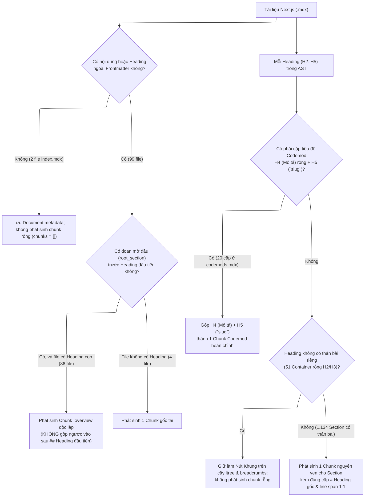
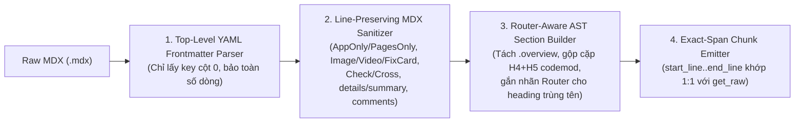

# Cấu Trúc Ngữ Nghĩa Tài Liệu Next.js & Thiết Kế Parser (`NextJSMDXParser`)

Tài liệu này đúc kết kết quả khảo sát toàn bộ **101 file MDX chính thức** của Next.js (`data/nextjs/`, tổng cộng **1.225 headings** bên ngoài code fences) và phân tích cách các quy ước biên soạn MDX của đội ngũ Next.js quyết định trực tiếp đến kiến trúc của [`NextJSMDXParser`](file:///home/hoang/python/rag-nlp/src/rag_eval/ingestion/parsers/nextjs_mdx.py).

---

## 1. Tổng Quan Bộ Tài Liệu Next.js (`data/nextjs/**/*.mdx`)

Khác với tài liệu Node.js vốn là đặc tả API cấp thấp phục vụ trình biên dịch `tools/doc/`, bộ tài liệu Next.js trong `data/nextjs/` là **tài liệu hướng dẫn kiến trúc và tác vụ kỹ thuật (Conceptual & Task-Oriented Guides)** viết bằng định dạng **MDX** (Markdown kết hợp các component JSX tùy chỉnh của trang `nextjs.org/docs`).

Toàn bộ **101 file `.mdx`** được tổ chức thành 2 phân khu chính:
- `01-getting-started/` (**19 file**): Luồng kiến thức cốt lõi của App Router (`01-installation.mdx` $\rightarrow$ `18-upgrading.mdx` và `index.mdx`).
- `02-guides/` (**82 file**): Các cẩm nang triển khai chuyên sâu, bao gồm các bài hướng dẫn đơn lẻ và 4 thư mục chuyên đề (`client-side-data-fetching/`: 3 file, `migrating/`: 4 file, `testing/`: 5 file, `upgrading/`: 6 file).

### 1.1. Phân bố cấp độ Heading trên toàn bộ 101 file

Các tác giả Next.js **không bao giờ dùng thẻ `# H1` trong thân bài** (100% tiêu đề bài viết được khai báo trong YAML frontmatter `title:`). Toàn bộ **1.225 headings** bên ngoài code fences phân bố như sau:

| Cấp độ Heading | Số lượng | Tỷ lệ | Là Container rỗng thân bài (đi liền trước heading con sâu hơn) | Có thân bài riêng (Prose / Code / Table / List) |
| :--- | ---: | ---: | ---: | ---: |
| `H1` (`#`) | 0 | 0.00% | 0 | 0 |
| `H2` (`##`) | 533 | 43.51% | 36 | 497 |
| `H3` (`###`) | 569 | 46.45% | 16 | 553 |
| `H4` (`####`) | 102 | 8.33% | 19 | 83 |
| `H5` (`#####`) | 21 | 1.71% | 0 | 21 |
| `H6` (`######`) | 0 | 0.00% | 0 | 0 |
| **Tổng cộng** | **1.225** | **100%** | **71 (5.80%)** | **1.154 (94.20%)** |

### 1.2. Phân loại 101 file theo cấu trúc thân bài

| Nhóm cấu trúc file | Số lượng file | Danh sách / Đặc điểm nhận diện |
| :--- | ---: | :--- |
| **File có đoạn mở đầu (`root_section`) + cây Heading (`H2`..`H5`)** | 86 file | Mở đầu bằng 1–5 đoạn văn/code tổng quan ngay dưới YAML frontmatter trước khi vào thẻ `##` đầu tiên. |
| **File vào thẳng `## Heading` đầu tiên (không có đoạn mở đầu)** | 9 file | Ngay sau YAML frontmatter là thẻ `##` đầu tiên (ví dụ [`02-project-structure.mdx`](file:///home/hoang/python/rag-nlp/data/nextjs/01-getting-started/02-project-structure.mdx), [`caching-without-cache-components.mdx`](file:///home/hoang/python/rag-nlp/data/nextjs/02-guides/caching-without-cache-components.mdx), [`local-development.mdx`](file:///home/hoang/python/rag-nlp/data/nextjs/02-guides/local-development.mdx), [`codemods.mdx`](file:///home/hoang/python/rag-nlp/data/nextjs/02-guides/upgrading/codemods.mdx)). |
| **File bài viết đơn mục (có thân bài nhưng không có bất kỳ Heading nào)** | 4 file | [`02-guides/custom-webpack.mdx`](file:///home/hoang/python/rag-nlp/data/nextjs/02-guides/custom-webpack.mdx), [`02-guides/json-ld.mdx`](file:///home/hoang/python/rag-nlp/data/nextjs/02-guides/json-ld.mdx), [`02-guides/multi-tenant.mdx`](file:///home/hoang/python/rag-nlp/data/nextjs/02-guides/multi-tenant.mdx), [`02-guides/upgrading/index.mdx`](file:///home/hoang/python/rag-nlp/data/nextjs/02-guides/upgrading/index.mdx). |
| **File chỉ mục thuần Frontmatter (không có thân bài sau `---`)** | 2 file | [`02-guides/index.mdx`](file:///home/hoang/python/rag-nlp/data/nextjs/02-guides/index.mdx) và [`02-guides/migrating/index.mdx`](file:///home/hoang/python/rag-nlp/data/nextjs/02-guides/migrating/index.mdx): chỉ chứa `title:` và `description:` trong YAML frontmatter để render trang danh mục trên web. |

---

## 2. Sáu Lớp Cú Pháp MDX Đặc Thù Ngoài CommonMark

Khảo sát toàn bộ 101 file bên ngoài các khối code fence (` ``` `) và inline code (`` `...` ``) cho thấy 6 lớp cú pháp MDX đặc thù mà bộ parser phải xử lý chính xác mà không làm lệch số dòng 1:1 (`[start_line, end_line]`):

### 2.1. Khối YAML Frontmatter đa tầng ở đầu file (101 / 101 file)
Mọi file đều mở đầu bằng khối YAML frontmatter:
```yaml
---
title: How Next.js supports AI coding agents
nav_title: AI Coding Agents
description: Learn how Next.js helps AI coding agents...
version: canary
related:
  title: Next Steps
  description: Learn more about the APIs and tools described in this guide.
  links:
    - app/guides/mcp
---
```
- **5 khóa cấp cao nhất (top-level keys, không thụt lề)**: `title` (101 file), `description` (101 file), `nav_title` (78 file), `related` (53 file), `version` (2 file).
- **Cạm bẫy cú pháp**: Trong **44 / 53 file** có khối `related:`, bên trong `related:` có các khóa con thụt đầu dòng là `  title: Next Steps` và `  description: ...` cùng danh sách `  links:`. Nếu trình đọc frontmatter chỉ tách theo dấu `:` mà không phân biệt khóa cấp 0 (không có khoảng trắng đầu dòng) với khóa con thụt lề, `related.description` sẽ ghi đè mất `description` chính của tài liệu!

### 2.2. Khối phân nhánh Router: `<AppOnly>` (89 khối) và `<PagesOnly>` (100 khối)
Đây là cấu trúc MDX quan trọng nhất của tài liệu Next.js:
- Có **29 file** chứa đồng thời cả `<AppOnly>...</AppOnly>` và `<PagesOnly>...</PagesOnly>` để trình bày cách làm tương ứng trên App Router và Pages Router trong cùng một bài viết.
- Trong đó, **26 khối `<AppOnly>`** và **17 khối `<PagesOnly>`** chứa các thẻ Heading (`##`, `###`, `####`) bên trong chúng.
- Đặc biệt, có **6 file** chứa **các thẻ Heading trùng hệt tên nhau** nằm lần lượt trong `<AppOnly>` và `<PagesOnly>` dưới cùng một mục cha:
  1. [`01-getting-started/02-project-structure.mdx`](file:///home/hoang/python/rag-nlp/data/nextjs/01-getting-started/02-project-structure.mdx#L81-L182): `### Dynamic routes` (dòng 81 trong `<AppOnly>`, dòng 171 trong `<PagesOnly>`).
  2. [`02-guides/authentication.mdx`](file:///home/hoang/python/rag-nlp/data/nextjs/02-guides/authentication.mdx#L425-L658): `### Creating a Data Access Layer (DAL)` (dòng 425 trong `<AppOnly>`, dòng 633 trong `<PagesOnly>`).
  3. [`02-guides/incremental-static-regeneration.mdx`](file:///home/hoang/python/rag-nlp/data/nextjs/02-guides/incremental-static-regeneration.mdx#L215-L230): `### Functions` (dòng 215 trong `<AppOnly>`, dòng 225 trong `<PagesOnly>`).
  4. [`02-guides/lazy-loading.mdx`](file:///home/hoang/python/rag-nlp/data/nextjs/02-guides/lazy-loading.mdx#L18-L240): `## next/dynamic` và `## Examples` (xuất hiện ở cả `<AppOnly>` và `<PagesOnly>`).
  5. [`02-guides/package-bundling.mdx`](file:///home/hoang/python/rag-nlp/data/nextjs/02-guides/package-bundling.mdx#L220-L355): `### Opting specific packages out of bundling` (dòng 220 trong `<AppOnly>`, dòng 341 trong `<PagesOnly>`).
  6. [`02-guides/static-exports.mdx`](file:///home/hoang/python/rag-nlp/data/nextjs/02-guides/static-exports.mdx#L49-L167): `## Supported Features` (dòng 49 trong `<AppOnly>`, dòng 153 trong `<PagesOnly>`).

**Hệ quả thiết kế**:
- Nếu chỉ xóa trắng `<AppOnly>` và `<PagesOnly>` thành khoảng trắng:
  1. Khi cả hai khối cùng nằm bên trong một section (ví dụ phần mở đầu của [`incremental-static-regeneration.mdx:27-204`](file:///home/hoang/python/rag-nlp/data/nextjs/02-guides/incremental-static-regeneration.mdx#L27-L204)), code và giải thích của App Router lẫn Pages Router bị nối liền nhau mà không có dấu hiệu phân biệt.
  2. Khi một Heading nằm hoàn toàn bên trong `<AppOnly>` hoặc `<PagesOnly>`, đặc biệt ở 6 file có heading trùng tên, việc không gắn ngữ cảnh Router khiến đường dẫn `ltree` bị đánh số vô nghĩa (`dynamic_routes_1`, `functions_1`, `next_dynamic_1`, `supported_features_1`) và `breadcrumbs` giống hệt nhau.
- Ngược lại, nếu chuyển dòng thẻ mở `<AppOnly>` thành dòng nhãn ngữ cảnh `**[App Router]**` và `<PagesOnly>` thành `**[Pages Router]**` (bảo toàn nguyên vẹn 1:1 số dòng), đồng thời khi một section được mở bên trong phạm vi `<AppOnly>` hoặc `<PagesOnly>` thì ghi nhận `router_context` (`"app"` / `"pages"`) để phân biệt khi trùng tên sibling (ví dụ `functions_app` / `functions_pages` hoặc đính kèm nhãn `(App Router)` / `(Pages Router)` vào breadcrumb khi disambiguate), cả văn bản bên trong chunk lẫn đường dẫn phân cấp đều rõ ràng, tường minh.

### 2.3. Các Component Đa phương tiện & Thẻ Chẩn đoán Tự đóng (`<Image>`, `<Video>`, `<FixCardGrid>/<FixCard>`)
Khảo sát toàn bộ các thẻ JSX mang dữ liệu trong thuộc tính (props) cho thấy 3 nhóm:
1. **`<Image ... />` (54 thẻ, đôi khi bọc trong `<div ...>...<span>caption</span></div>`)**:
   - Đa dòng (6–9 dòng), chứa `alt="..."`, `caption="..."`, `srcLight="..."`, `srcDark="..."`, hoặc `src="..."`.
   - Lưu ý tại [`package-bundling.mdx:65-71`](file:///home/hoang/python/rag-nlp/data/nextjs/02-guides/package-bundling.mdx#L65-L71): tác giả truyền `caption="Next.js Bundle Analyzer import chain view"` trực tiếp làm prop của `<Image>` mà không có `alt="..."`!
2. **`<Video ... />` (1 thẻ tại [`package-bundling.mdx:52-57`](file:///home/hoang/python/rag-nlp/data/nextjs/02-guides/package-bundling.mdx#L52-L57))**:
   - Đa dòng (6 dòng), chứa `caption="Next.js bundle analyzer UI walkthrough"` và `src="/videos/bundle-analyzer.mp4"`.
3. **`<FixCardGrid>` & `<FixCard ... />` (20 thẻ `<FixCard>` trong 22 thẻ `<FixCardGrid>` tại [`08-caching.mdx`](file:///home/hoang/python/rag-nlp/data/nextjs/01-getting-started/08-caching.mdx#L140-L151), [`adopting-partial-prefetching.mdx`](file:///home/hoang/python/rag-nlp/data/nextjs/02-guides/adopting-partial-prefetching.mdx), [`instant-navigation.mdx`](file:///home/hoang/python/rag-nlp/data/nextjs/02-guides/instant-navigation.mdx))**:
   - Chứa thông tin sửa lỗi quan trọng trong thuộc tính `title="..."`, `href="..."`, và `snippets={[...]}`. Nếu bị xóa trắng bởi bộ lọc JSX tag chung, toàn bộ nội dung thẻ hướng dẫn sửa lỗi bị biến mất khỏi chunk.

**Cạm bẫy lệch `end_line` khi rút gọn thẻ JSX nhiều dòng**:
Khi một khối `<Image ... />`, `<Video ... />`, hoặc `<FixCardGrid>...</FixCardGrid>` dài $K$ dòng ở cuối một section được thay thế bằng 1 dòng Markdown ở dòng đầu tiên cộng với $(K-1)$ dòng trống (`\n`) ở dưới, bộ parser AST `markdown-it` sẽ coi $(K-1)$ dòng trống cuối đó là khoảng trắng nằm ngoài node cuối cùng của section! Hệ quả là `node.map[1]` (`end_line` của section) bị hụt mất $(K-1)$ dòng và dừng ngay ở dòng mở thẻ `<Image` đầu tiên.
- **Quy tắc bảo toàn cả `start_line` lẫn `end_line`**: Khi thay thế một khối JSX nhiều dòng từ dòng $L_{\text{start}}$ đến $L_{\text{end}}$ (tổng $K$ dòng), dòng tổng hợp phải đảm bảo có token văn bản ở dòng cuối cùng $L_{\text{end}}$ (hoặc đặt các dòng đệm ở phía trên dòng tổng hợp / giữ dòng đóng ở dòng $L_{\text{end}}$) sao cho `node.map[1]` của `markdown-it` bao phủ trọn vẹn đến đúng dòng đóng `/>` (dòng $L_{\text{end}}$) trong `raw_text`!

### 2.4. Ký hiệu Trạng thái Trong Bảng (`<Check />`, `<Cross />`) và Khối Thu gọn (`<details>/<summary>`)
- **`<Check size={18} />` (2 lần) và `<Cross size={18} />` (1 lần)** tại [`01-getting-started/15-route-handlers.mdx:159-161`](file:///home/hoang/python/rag-nlp/data/nextjs/01-getting-started/15-route-handlers.mdx#L159-L161): Đặt bên trong các ô của bảng Markdown (`| <Cross size={18} /> Conflict |`, `| <Check size={18} /> Valid |`). Phải được chuyển thành ký hiệu văn bản `✗` và `✓` thay vì xóa trắng.
- **`<details>` & `<summary>` (24 khối)**: Dùng cho danh sách `Examples` đầu bài hoặc câu hỏi phụ. Thẻ `<summary>Title</summary>` cần được chuyển thành `**Title**` để giữ rõ tiêu đề khối thu gọn mà không làm lệch dòng.

### 2.5. Chú thích MDX (`{/* ... */}`) và Thẻ Neo Độc lập (`<span id="..." />`)
- **Chú thích `{/* ... */}` (30 lần ngoài code fence)**: Ghi chú biên tập nội bộ của tác giả Next.js (ví dụ `{/* xref to the sync io section ... */}` tại `08-caching.mdx:155`), cần được làm trống trên cùng dòng.
- **Thẻ neo độc lập `<span id="..." />` (3 lần tại [`02-guides/ai-agents.mdx:20,122,193`](file:///home/hoang/python/rag-nlp/data/nextjs/02-guides/ai-agents.mdx#L20))**: Đặt ngay phía trước thẻ `## Heading` tiếp theo để làm neo liên kết (`<span id="step-1-point-agents-at-the-bundled-docs" />` ở dòng 20 trước `## Version-matched documentation` ở dòng 22). Nếu không làm trống hoàn toàn, nó hoặc bị dính vào cuối chunk đứng trước.
- **Các thẻ JSX minh họa nằm trong câu văn nhưng không bọc backtick** (`<Suspense>`, `<DataChild />`, `<Details params={params} />`, `<Link>`): Xuất hiện trực tiếp trong thân `FixCard` hoặc văn xuôi; sau khi xử lý `FixCard` xong, các thẻ JSX inline còn sót ngoài code fence cần được bảo toàn hoặc tháo vỏ an toàn mà không làm mất tên component khi nó đóng vai trò danh từ trong câu.

---

## 3. Phân Loại Ngữ Nghĩa Cây Heading Trong Tài Liệu Next.js

Khảo sát toàn bộ **1.225 headings** trên 101 file cho thấy các tác giả Next.js sử dụng thẻ Heading theo **4 vai trò ngữ nghĩa** rõ rệt:



### Vai trò 1: Phần Tổng Quan Mở Đầu Tài Liệu (`root_section`, `level = 0`) — 90 file
- Trong **86 file** có cả phần mở đầu lẫn các thẻ `## Heading` bên dưới, phần mở đầu (`root_section`) luôn đóng vai trò **Tổng quan của toàn bộ chủ đề** (định nghĩa khái niệm, bảng tóm tắt, hoặc ví dụ tối thiểu cho toàn bài như ở [`incremental-static-regeneration.mdx:7-204`](file:///home/hoang/python/rag-nlp/data/nextjs/02-guides/incremental-static-regeneration.mdx#L7-L204)).
- **Tại sao không được gộp `root_section` vào `first_child`?**
  1. **Vi phạm tính bảo toàn thứ tự dòng với `get_raw`**: Khi gộp `root_section` (dòng $s_{\text{root}}..e_{\text{root}}$) vào sau dòng tiêu đề `## First Child` (dòng $s_{\text{child}}$), `verbatim_text` có dòng tiêu đề `## First Child` đứng trước phần mở đầu, ngược hẳn với `raw_text`!
  2. **Làm hỏng các file có `first_child` là Container rỗng**: Khi thẻ `##` đầu tiên của bài là một container thuần phân mục (không có thân bài riêng, như `## Folder and file conventions` ở [`02-project-structure.mdx:9`](file:///home/hoang/python/rag-nlp/data/nextjs/01-getting-started/02-project-structure.mdx#L9) hoặc `## Reference` ở [`incremental-static-regeneration.mdx:206`](file:///home/hoang/python/rag-nlp/data/nextjs/02-guides/incremental-static-regeneration.mdx#L206)), việc gộp `root_section` vào `first_child` biến toàn bộ phần giới thiệu đầu bài thành nội dung của container rỗng đó, đồng thời làm `end_line` dừng ở dòng tiêu đề của container rỗng!
- **Quy tắc chuẩn**:
  - Nếu file có các section con (`H2`..`H5`) và `root_section` có nội dung thực: phát sinh `root_section` thành một chunk độc lập có đường dẫn `<doc_slug>.overview` (với `start_line` và `end_line` khớp chính xác vùng đầu bài trước thẻ `##` đầu tiên, tiêu đề `# {effective_title}` và `node_type = "OVERVIEW"`).
  - Nếu file không có bất kỳ thẻ Heading nào (**4 file** đơn mục): phát sinh chunk tại `<doc_slug>`.
  - Với **2 file chỉ mục** ([`02-guides/index.mdx`](file:///home/hoang/python/rag-nlp/data/nextjs/02-guides/index.mdx), [`02-guides/migrating/index.mdx`](file:///home/hoang/python/rag-nlp/data/nextjs/02-guides/migrating/index.mdx)) chỉ có YAML frontmatter (`title`, `description`) mà không có thân bài: chỉ lưu metadata cấp `Document` và trả về `chunks=[]`, không ép sinh chunk từ frontmatter.

### Vai trò 2: Nút Khung Phân Loại Rỗng Thân Bài (Pure Structural Containers) — 51 nodes (`36 H2` + `15 H3`)
- Là các thẻ `H2` hoặc `H3` được tác giả dùng thuần túy để gom nhóm các mục con bên dưới mà **không có bất kỳ dòng văn xuôi hay code nào ở giữa nó và thẻ Heading con đầu tiên**:
  - Ví dụ ở `H2` (36 nút): `## Folder and file conventions` (`02-project-structure.mdx:9`), `## Examples` (`04-linking-and-navigating.mdx:232`, `05-server-and-client-components.mdx:264`, `06-fetching-data.mdx:211`, `07-mutating-data.mdx:302`, `incremental-static-regeneration.mdx:232`...), `## Reference` (`incremental-static-regeneration.mdx:206`), `## Troubleshooting` (`incremental-static-regeneration.mdx:545`, `version-15.mdx:223`), `## Codemods` (`codemods.mdx:72`).
  - Ví dụ ở `H3` (15 nút): `### Metadata file conventions` (`02-project-structure.mdx:116`), các mốc phiên bản `### 16.3`, `### 16.0`, `### 15.0`, `### 14.0`, `### 13.2`, `### 13.0`, `### 11`, `### 10`, `### 9`, `### 6` trong `codemods.mdx`, hay `### cookies`, `### headers`, `### draftMode`, `### params & searchParams` trong `version-15.mdx`.
- **Quy tắc chuẩn**: Giữ nguyên các nút này trên ngăn xếp phân cấp để truyền đầy đủ `ltree` path và `breadcrumbs` (`ancestor_titles`) xuống cho các nút con, nhưng **không phát sinh chunk rỗng** cho bản thân nút khung.

### Vai trò 3: Cặp Tiêu Đề Kép Mô Tả + Định Danh Codemod (`H4` + `H5`) — 20 cặp trong `codemods.mdx`
- Khảo sát toàn bộ **19 thẻ `H4` rỗng thân bài** và **21 thẻ `H5`** trên toàn bộ corpus cho thấy:
  - **19 / 19 thẻ `H4` rỗng thân bài** (cùng 1 thẻ `H4` có 1 câu dẫn ngắn là `#### Migrate to async Dynamic APIs` ở `codemods.mdx:289`) và **20 / 21 thẻ `H5`** nằm hoàn toàn trong file [`02-guides/upgrading/codemods.mdx`](file:///home/hoang/python/rag-nlp/data/nextjs/02-guides/upgrading/codemods.mdx#L76-L750)!
  - Trong `codemods.mdx`, mỗi codemod được tác giả biên soạn theo cấu trúc cặp tiêu đề:
    ```markdown
    #### Opt every route out of Cache Components validation

    ##### `cache-components-instant-false`

    This codemod adds `export const instant = false`...
    ```
  - Nếu tách rời `####` và `#####`, thẻ `####` (chứa mô tả ngữ nghĩa quan trọng nhất về tác dụng của codemod) bị coi là container rỗng và không nằm trong `verbatim_text` của chunk `#####`!
- **Quy tắc chuẩn**: Khi một thẻ `H5` là tên định danh codemod (bọc trong backtick `` `...` ``) nằm ngay dưới một thẻ `H4` cùng mô tả codemod đó (khi `H4` chỉ có duy nhất 1 con là `H5` này), gộp `H4` và `H5` thành **một đơn vị chunk duy nhất** có `start_line` từ dòng `####` đến hết thân `#####`, bao gồm cả tiêu đề `#### <Mô tả>` và `##### <slug>` trong `verbatim_text`.
- *(Thẻ `H5` duy nhất còn lại trong toàn bộ corpus là `##### Cross-route segment behavior` tại [`caching-without-cache-components.mdx:177`](file:///home/hoang/python/rag-nlp/data/nextjs/02-guides/caching-without-cache-components.mdx#L177), là một tiểu mục giải thích hành vi bên trong cấu hình `#### fetchCache`, giữ nguyên làm section con hoặc gộp tự nhiên).*

### Vai trò 4: Đơn Vị Mục Hướng Dẫn / Tham Chiếu Độc Lập (`H2`, `H3`, `H4`) — ~1.134 sections
- Mọi mục `H2`, `H3`, `H4` có thân bài riêng đều đại diện cho một khái niệm, một bước triển khai (`Step 1: ...`), một cấu hình, hoặc một mẫu ví dụ hoàn chỉnh.
- Mỗi mục giữ nguyên cấp độ dấu thăng gốc (`##`, `###`, `####`) ở dòng mở đầu của `verbatim_text`, khớp chính xác với dòng `start_line` trên `documents.raw_text`.

---

## 4. Đặc Tả Kiến Trúc `NextJSMDXParser` & Các Quy Tắc Bảo Toàn Dòng 1:1



### 4.1. Tiền xử lý YAML Frontmatter & Cú pháp MDX bảo toàn 1:1 số dòng (`_sanitize_nextjs_content`)

1. **Trích xuất YAML Frontmatter không bị ghi đè bởi khóa con**:
   - Chỉ trích xuất các khóa nằm ở **cột 0** (không có khoảng trắng thụt đầu dòng: `re.match(r"^([a-zA-Z0-9_-]+)\s*:\s*(.*)$", line)`), nhờ đó `title` và `description` bên trong khối `related:` không bao giờ ghi đè `title` và `description` của tài liệu.
   - Thay thế các dòng frontmatter bằng dòng khoảng trắng `" "` để giữ nguyên chỉ số dòng 1:1.

2. **Theo dõi và hiển thị ngữ cảnh `<AppOnly>` / `<PagesOnly>`**:
   - Thay vì xóa trắng `<AppOnly>` và `<PagesOnly>`, thay dòng mở `<AppOnly>` bằng dòng đánh dấu ngữ cảnh `**[App Router]**` (hoặc thẻ đóng bằng khoảng trắng `" "`) khi nằm trong cùng một section, đồng thời theo dõi phạm vi dòng `router_ranges` (`"app"` vs `"pages"`) để mỗi Heading sinh ra bên trong `<AppOnly>` hoặc `<PagesOnly>` biết chính xác nó thuộc Router nào.
   - Khi hai Heading anh em dưới cùng một nút cha có cùng tên tiêu đề nhưng nằm ở hai khối `<AppOnly>` và `<PagesOnly>` khác nhau (6 trường hợp trong corpus), hậu tố đường dẫn `ltree` được phân biệt tường minh thành `_app` / `_pages` (hoặc giữ nguyên tên cho bản đầu và gắn `_pages_router` / nhãn `[App Router]` / `[Pages Router]` trong `breadcrumbs`), loại bỏ hoàn toàn hiện tượng đụng độ mù `_1`.

3. **Biến đổi `<Image>`, `<Video>`, `<FixCardGrid>/<FixCard>`, `<Check>/<Cross>`, `<details>/<summary>` không làm hụt `end_line`**:
   - Với `<Check ... />` $\rightarrow$ `✓`; `<Cross ... />` $\rightarrow$ `✗`.
   - Với `<summary>...</summary>` $\rightarrow$ `**...**`.
   - Với `<Image ... />` (hỗ trợ cả `alt` lẫn `caption` prop) và `<Video ... />`: chuyển thành `` (hoặc `[Video: caption](src)`).
   - Với `<FixCard ... />`: trích xuất `title` và `href` thành `- **[Fix: {title}]({href})**`.
   - **Bảo toàn `end_line` cho các khối JSX nhiều dòng**: Khi một khối `<Image ... />`, `<Video ... />`, hoặc `<FixCardGrid>...</FixCardGrid>` chiếm $K$ dòng ($K > 1$, từ dòng $s$ đến dòng $e$), đặt $(K - 1)$ dòng trống ở **phía trước** dòng Markdown tổng hợp (hoặc đặt dòng tổng hợp ở đúng dòng cuối $e$ của khối JSX), sau đó khi kết thúc gom dòng của section sẽ loại bỏ các dòng trống thừa giữa các đoạn văn. Nhờ đặt dòng văn bản tổng hợp ở đúng dòng cuối $e$ của khối JSX:
     - Token AST trong `markdown-it` có `node.map[1] == e` (khớp chính xác 100% với dòng đóng `/>` hoặc `</FixCardGrid>` trong `raw_text`!).
     - Đồng thời, mọi dòng phía sau khối JSX vẫn giữ nguyên chỉ số dòng 1:1 tuyệt đối!

---

## 5. Nhật Ký Kiểm Định Vòng Lặp (Verification & Accretion Log)

Sau khi nạp toàn bộ **101 file `.mdx`** (`99` tài liệu có thân bài thực, sinh ra `1.239` chunks; `2` file chỉ mục thuần frontmatter sinh `0` chunks) vào PostgreSQL với `--no-embed` và kiểm định đồng thời qua SQL + CLI (`hierarchical_navigate`, `hybrid_search`, `get_raw`), dưới đây là toàn bộ các quy tắc biên đã tinh chỉnh, các heuristic đã bác bỏ và các đánh đổi cấu trúc được bảo toàn:

### 5.1. Các Lỗi Triển Khai & Quy Tắc Biên Đã Xử Lý (Loop 1 & Loop 2 Refinements)

1. **Tách riêng `<doc_slug>.overview` thay vì gộp ngược vào `first_child` (`86` tài liệu)**:
   - **Hiện tượng cũ**: `root_section.content_lines` bị ghép vào *sau* dòng tiêu đề `## <First Heading>` của chunk đầu tiên, làm đảo ngược thứ tự dòng so với `raw_text` trên 86 chunks và làm toàn bộ 200 dòng mở đầu + ví dụ của [`02-guides/incremental-static-regeneration.mdx:7-204`](file:///home/hoang/python/rag-nlp/data/nextjs/02-guides/incremental-static-regeneration.mdx#L7-L204) bị nhét nhầm vào container rỗng `## Reference` (`L8-206`).
   - **Quy tắc chuẩn**: Phát sinh `root_section` có nội dung thành chunk `<doc_slug>.overview` (`node_type = "OVERVIEW"`, `start_line`..`end_line` nằm trọn trước thẻ `##` đầu tiên). Với 2 file chỉ mục thuần frontmatter ([`02-guides/index.mdx`](file:///home/hoang/python/rag-nlp/data/nextjs/02-guides/index.mdx), [`02-guides/migrating/index.mdx`](file:///home/hoang/python/rag-nlp/data/nextjs/02-guides/migrating/index.mdx)), trả về `chunks=[]` để không tạo chunk giả từ YAML frontmatter.

2. **Bảo toàn `end_line` 1:1 cho khối JSX nhiều dòng (`<Image>`, `<Video>`, `<FixCardGrid>`)**:
   - **Hiện tượng cũ**: Đặt dòng trống `\n` ở *sau* dòng Markdown tổng hợp khiến `markdown-it` cắt `node.map[1]` (`end_line`) ngay tại dòng mở thẻ `<Image` đầu tiên (lệch 5–8 dòng ở mọi section kết thúc bằng `<Image ... />` như [`02-project-structure.mdx:305-315`](file:///home/hoang/python/rag-nlp/data/nextjs/01-getting-started/02-project-structure.mdx#L305-L315)).
   - **Quy tắc chuẩn**: Đặt `(orig_newlines - rep_newlines)` dòng trống lên *phía trên* dòng Markdown tổng hợp và lưu ánh xạ `multiline_jsx_start_map[first_synthesized_0] = block_start_0`. Nhờ đó `block_start` luôn trỏ về dòng mở thẻ và `block_end` luôn trỏ đúng dòng đóng `/>` hoặc `</FixCardGrid>`.

3. **Cắt bỏ dòng trống cuối danh sách (`bullet_list` / `ordered_list`) trong `markdown-it` (`118` sections)**:
   - **Hiện tượng ở Vòng 1**: Trong `markdown-it`, `node.map[1]` của token `bullet_list` và `ordered_list` luôn bao gồm cả dòng trống kết thúc danh sách (hoặc dòng thẻ đóng `</AppOnly>` đã làm trống), làm `end_line` của 118 chunks kết thúc bằng danh sách bị dư 1 dòng trống so với `raw_text`.
   - **Quy tắc chuẩn (Vòng 2)**: Thu hẹp `trimmed_e_0` lùi về dòng có nội dung cuối cùng (`while trimmed_e_0 > s_0 + 1 and not clean_lines[trimmed_e_0 - 1].strip(): trimmed_e_0 -= 1`), đưa số lỗi lệch `end_line` từ `118` về **`0`**.

4. **Tháo vỏ thẻ tự đóng không có khoảng trắng `<br/>` và bảo toàn thụt lề Code Fence**:
   - **Hiện tượng ở Vòng 1**: Biểu thức chính quy `_unwrap_tag` cũ yêu cầu `\s+` trước `/>`, bỏ sót 2 thẻ `<br/>` trong bảng [`02-guides/third-party-libraries.mdx:474-478`](file:///home/hoang/python/rag-nlp/data/nextjs/02-guides/third-party-libraries.mdx#L474-L478); đồng thời việc rút gọn khoảng trắng `re.sub(r"[ \t]+", " ", l)` sau khi khôi phục code block đã xóa mất toàn bộ thụt lề đa tầng trong code TypeScript/JSX.
   - **Quy tắc chuẩn (Vòng 2)**: Mở rộng regex tháo thẻ thành `(?:\s+[^>]*?)?\s*/?>` và thực hiện chuẩn hóa khoảng trắng văn xuôi *trước* khi khôi phục `__MASKED_CODE_{idx}__`.

5. **Phân định `<AppOnly>` / `<PagesOnly>` và Gộp cặp tiêu đề `H4 + H5` trong `codemods.mdx`**:
   - Chuyển toàn bộ 6 cặp heading trùng tên giữa `<AppOnly>` và `<PagesOnly>` sang hậu tố `_pages` kèm breadcrumb `(App Router)` / `(Pages Router)` (xóa bỏ 100% hậu tố đụng độ mù `_1`).
   - Chỉ chèn nhãn `**[App Router]**` / `**[Pages Router]**` vào thân bài khi bên trong cùng một section có sự chuyển tiếp giữa nhiều trạng thái router (`len(block_router_states) > 1`).
   - Gộp 20 cặp `#### <Mô tả>` + `##### <codemod-slug>` trong [`02-guides/upgrading/codemods.mdx:76-750`](file:///home/hoang/python/rag-nlp/data/nextjs/02-guides/upgrading/codemods.mdx#L76-L750) thành các chunk codemod hoàn chỉnh, đồng thời rút gọn đường dẫn `ltree` của nút `H5` thành con trực tiếp của nút phiên bản `H3` (`<doc_slug>.codemods.<version>.<codemod_slug>`) và đồng bộ độ dài `metadata["ancestor_titles"]` khớp 1:1 với số phân đoạn `ltree` sau `doc_slug` (kể cả khi tiêu đề `H2` trùng tên với `title` của tài liệu như `Codemods > Codemods` hay `Authentication > Authentication`) để `hierarchical_navigate` (`CHILDREN` / `PARENT_CHAIN`) không bị lệch chỉ số tổ tiên.

---

### 5.2. Các Heuristic Đã Bác Bỏ (Rejected Heuristics)

| Heuristic bị bác bỏ | Lý do bác bỏ & Các Chunk hợp lệ sẽ bị phá hỏng nếu áp dụng |
| :--- | :--- |
| **Gộp đoạn mở đầu (`root_section`) vào section con đầu tiên (`first_child`)** | Đảo ngược thứ tự dòng giữa `verbatim_text` và `get_raw` trên **86 chunks**, đồng thời nhét nhầm phần giới thiệu + code ví dụ của cả bài vào các container rỗng đứng đầu bài như `## Folder and file conventions` ([`02-project-structure.mdx:9`](file:///home/hoang/python/rag-nlp/data/nextjs/01-getting-started/02-project-structure.mdx#L9)) và `## Reference` ([`incremental-static-regeneration.mdx:206`](file:///home/hoang/python/rag-nlp/data/nextjs/02-guides/incremental-static-regeneration.mdx#L206)). |
| **Gộp các section cha có đoạn dẫn ngắn (`< 150` ký tự) vào section con đầu tiên** | Sẽ làm mất nút tổng quan cấp cha trên cây điều hướng `hierarchical_navigate` đối với **25 mục cha** có đoạn định nghĩa ngắn trước khi chia mục con (ví dụ `## Removals` ở [`version-16.mdx:1026-1028`](file:///home/hoang/python/rag-nlp/data/nextjs/02-guides/upgrading/version-16.mdx#L1026-L1028), `## Supported Features` ở [`static-exports.mdx:49-51`](file:///home/hoang/python/rag-nlp/data/nextjs/02-guides/static-exports.mdx#L49-L51), `## Google Third-Parties` ở [`third-party-libraries.mdx:37-39`](file:///home/hoang/python/rag-nlp/data/nextjs/02-guides/third-party-libraries.mdx#L37-L39)). |
| **Gộp tất cả thẻ `H4` / `H5` vào `H3` cha theo độ sâu cố định** | Sẽ nuốt mất **83 mục `H4` độc lập** như các bước hướng dẫn `#### 1. Capture user credentials`, `#### 2. Validate form fields on the server`, `#### 3. Create a user or check user credentials` trong [`authentication.mdx:41-150`](file:///home/hoang/python/rag-nlp/data/nextjs/02-guides/authentication.mdx#L41-L150) hoặc `#### window.history.pushState` / `#### window.history.replaceState` trong [`04-linking-and-navigating.mdx:257-262`](file:///home/hoang/python/rag-nlp/data/nextjs/01-getting-started/04-linking-and-navigating.mdx#L257-L262) thành các siêu chunk dài trên `15.000` ký tự. |

---

### 5.3. Các Đánh Đổi Cấu Trúc Được Bảo Toàn (Preserved Structural Tradeoffs)

1. **Các chunk mục cha có câu dẫn ngắn (`68`–`120` ký tự)**:
   - Ví dụ: `nextjs.02_guides.upgrading.version_16.removals` ([`version-16.mdx:1026-1028`](file:///home/hoang/python/rag-nlp/data/nextjs/02-guides/upgrading/version-16.mdx#L1026-L1028), `75` ký tự), `nextjs.01_getting_started.17_deploying.static_export.templates` ([`17-deploying.mdx:72-75`](file:///home/hoang/python/rag-nlp/data/nextjs/01-getting-started/17-deploying.mdx#L72-L75), `78` ký tự), `nextjs.02_guides.upgrading.codemods.codemods.8` ([`codemods.mdx:708-710`](file:///home/hoang/python/rag-nlp/data/nextjs/02-guides/upgrading/codemods.mdx#L708-L710), `89` ký tự).
   - **Lý do giữ nguyên**: Đây là văn bản thực sự do tác giả viết tại mục đó (ví dụ thông báo codemod của Next.js 8 đã bị gỡ bỏ ở Next.js 16, hoặc mục `Templates` chỉ chứa 1 link template GitHub Pages). Giữ nguyên giúp bảo toàn cấu trúc cây `ltree` và khớp dòng 1:1 với `get_raw`.
2. **Các chunk hướng dẫn từng bước có kèm code đầy đủ dài `5.500`–`8.787` ký tự**:
   - Ví dụ: `nextjs.02_guides.progressive_web_apps.creating_a_pwa_with_next_js.2_implementing_web_push_notifications` ([`progressive-web-apps.mdx:84-408`](file:///home/hoang/python/rag-nlp/data/nextjs/02-guides/progressive-web-apps.mdx#L84-L408), `8.787` ký tự sau khi giữ nguyên thụt lề code), `nextjs.02_guides.keeping_pages_static.example.step_3_prerender_the_buying_guides` ([`keeping-pages-static.mdx:220-475`](file:///home/hoang/python/rag-nlp/data/nextjs/02-guides/keeping-pages-static.mdx#L220-L475), `7.939` ký tự).
   - **Lý do giữ nguyên**: Mỗi mục này là một bước triển khai đơn nhất (`Step 2`, `Step 3`) chứa các khối code TypeScript/JSX song ngữ (`switcher`). Không cắt mảnh bằng ngưỡng ký tự để không làm đứt lìa đoạn giải thích với khối code minh họa.

