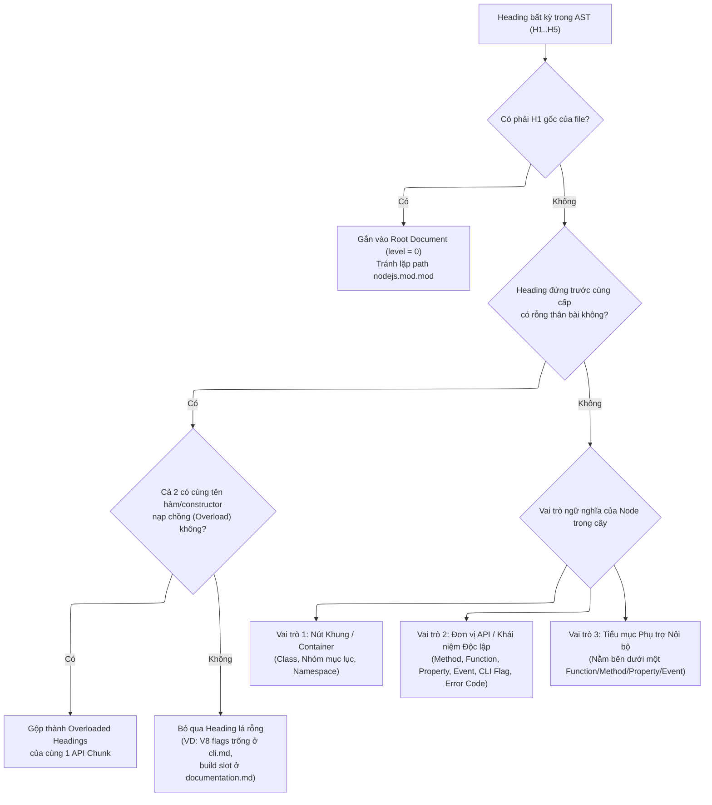
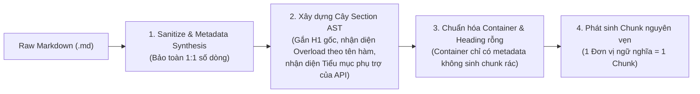

# Cấu Trúc Ngữ Nghĩa Tài Liệu Node.js & Thiết Kế Parser (`NodeJSMarkdownParser`)

Tài liệu này đúc kết kết quả khảo sát toàn bộ **66 file Markdown chính thức** của Node.js (`v22.x`, thư mục `doc/api/*.md`, tổng cộng **4.607 headings**) và phân tích cách các quy ước biên soạn của tác giả Node.js quyết định trực tiếp đến kiến trúc của `NodeJSMarkdownParser`.

---

## 1. Tổng Quan Bộ Tài Liệu Node.js (`doc/api/*.md`)

Khác với tài liệu hướng dẫn theo luồng bài học (tutorial/guide) như Next.js, tài liệu chính thức của Node.js là **tài liệu đặc tả API kết hợp cẩm nang kỹ thuật** (API Reference & Technical Manual), được biên soạn để phục vụ đồng thời hai mục đích:
1. Render thành trang HTML cho người đọc.
2. Biên dịch tự động sang cấu trúc `.json` thông qua bộ công cụ nội bộ `tools/doc/` của Node.js để phục vụ IDE và công cụ tra cứu (như được nêu tại `documentation.md:78-85`).

Vì phải phục vụ trình biên dịch tài liệu nội bộ, các tác giả Node.js tuân thủ một hệ thống quy ước cú pháp chặt chẽ bên trong Markdown. Toàn bộ 66 file gồm **4.607 headings** phân bố như sau:

| Cấp độ Heading | Số lượng | Tỷ lệ | Có mặt khối `<!-- YAML -->` ngay dưới Heading | Không có `<!-- YAML -->` |
| :--- | ---: | ---: | ---: | ---: |
| `H1` (`#`) | 65 | 1.41% | 63 (gồm `introduced_in`) | 2 |
| `H2` (`##`) | 787 | 17.08% | 548 | 239 |
| `H3` (`###`) | 2.707 | 58.76% | 2.031 | 676 |
| `H4` (`####`) | 908 | 19.71% | 656 | 252 |
| `H5` (`#####`) | 140 | 3.04% | 73 | 67 |
| `H6` (`######`) | 0 | 0.00% | 0 | 0 |
| **Tổng cộng** | **4.607** | **100%** | **3.371 (73.17%)** | **1.236 (26.83%)** |

*(Lưu ý: Duy nhất file `synopsis.md` dùng hai thẻ `H2` thay vì `H1`, nên có 65 thẻ `H1` trên 66 file).*

---

## 2. Các Thành Phần Cú Pháp Đặc Thù Của Node.js Markdown

Trước khi xét đến cây Heading, mỗi file `.md` của Node.js chứa 6 lớp cú pháp đặc thù ngoài CommonMark thông thường:

### 2.1. Chỉ thị cấp Module (HTML Comments đầu file)
Ngay dưới thẻ `# H1` đầu tiên của mỗi file, tác giả nhúng các chỉ thị dạng HTML comment một dòng:
- `<!--introduced_in=v0.10.0-->` (66 lần): Phiên bản Node.js giới thiệu module.
- `<!-- source_link=lib/events.js -->` (43 lần): Đường dẫn tới file mã nguồn trong repo `nodejs/node`.
- `<!-- name=events -->` (9 lần): Định danh tên module cho trình xuất JSON.
- `<!-- type=misc -->`, `<!-- type=class -->`, `<!-- type=module -->`, `<!-- type=global -->` (69 lần): Chỉ thị phân loại cho trình sinh JSON của Node.js.

### 2.2. Khối lịch sử phiên bản `<!-- YAML ... -->`
Ngay dưới 73% số heading (3.371 headings), tác giả đặt một khối HTML comment nhiều dòng chứa cấu trúc YAML:
```markdown
## `fs.readFile(path[, options], callback)`
<!-- YAML
added: v0.1.29
changes:
  - version:
      - v14.18.0
      - v12.22.0
    pr-url: https://github.com/nodejs/node/pull/37608
    description: The `options` argument may include an `AbortSignal`...
-->
```
- Trường `added` và `deprecated` có thể viết trên một dòng (`added: v1.0.0`) hoặc danh sách nhiều dòng (`added:\n  - v14.0.0\n  - v12.18.0`).
- Trường `changes` chứa toàn bộ lịch sử PR (`pr-url`, `commit`) qua hàng chục phiên bản, đôi khi dài tới 40–60 dòng nhưng chỉ mang tính lịch sử phát hành, làm nhiễu nặng ngữ nghĩa nếu giữ nguyên hoặc làm sai lệch số dòng (`start_line`/`end_line`) nếu cắt bỏ trực tiếp khỏi văn bản trước khi parse AST.

### 2.3. Chỉ số ổn định (`> Stability: N - ...`)
Đặt trong blockquote ngay đầu module, đầu class, hoặc đầu một hàm/phương thức:
- `> Stability: 0 - Deprecated`
- `> Stability: 1 - Experimental` (kèm các phân cấp `1.0`, `1.1`, `1.2`)
- `> Stability: 2 - Stable`
- `> Stability: 3 - Legacy`

### 2.4. Thẻ neo HTML rỗng (`<a id="..."></a>`) đứng trước Heading kế tiếp
Để giữ tương thích ngược cho các đường link cũ trên web, tác giả đặt thẻ `<a id="..."></a>` **phía trước** heading mà nó trỏ tới (ví dụ `cli.md:3889-3893`, `errors.md`, `fs.md`):
```markdown
<!-- Anchor to make sure old links find a target -->
<a id="--max-old-space-sizesize-in-megabytes"></a>

### `--max-old-space-size=SIZE` (in MiB)
```
Trong cây AST của Markdown thông thường, mọi phần tử nằm *trước* một thẻ `### Heading` đều bị归 (gán) vào cuối thân của **section đứng trước đó**. Nếu không loại bỏ các thẻ neo rỗng này trước khi chia section, thẻ `<a id="B"></a>` của mục B sẽ bị dính vào đáy chunk của mục A.

### 2.5. Vùng Build-Slot tự động (`<!-- v8-options -->`, `<!-- STABILITY_OVERVIEW_SLOT -->`)
Một số file có các vùng đánh dấu cho công cụ build:
- `documentation.md:72-76`: Mục `## Stability overview` chỉ chứa cặp comment `<!-- STABILITY_OVERVIEW_SLOT_BEGIN --> ... <!-- STABILITY_OVERVIEW_SLOT_END -->` mà không có nội dung văn bản tĩnh.
- `cli.md:3871-3960`: Trong vùng `<!-- v8-options start --> ... <!-- v8-options end -->`, tác giả liệt kê 14 thẻ `### --flag` **hoàn toàn trống không có thân bài** (như `### --abort-on-uncaught-exception`, `### --expose-gc`, `### --jitless`, `### --prof`) vì các flag này đã được tài liệu hóa chi tiết ở phần trên của file `cli.md`, xen kẽ với 3 flag có thân bài (`--max-old-space-size`, `--max-semi-space-size`, `--stack-trace-limit`).

### 2.6. Bảng định nghĩa Reference Links ở đáy mỗi file
Cuối mỗi file `.md` của Node.js luôn là hàng trăm dòng định nghĩa link tham chiếu theo cú pháp `[label]: other_module.md#anchor` (dùng cho các liên kết dạng `[EventEmitter][]` trong bài). Trong `markdown-it`, các dòng định nghĩa này được tiêu thụ vào `env` của bộ parser và **không sinh ra token AST** nào, nên tự động không bị lọt vào thân của chunk cuối cùng.

---

## 3. Quy Luật Cấu Trúc Cây Heading Trong Tài Liệu Node.js

Khảo sát toàn bộ 4.607 headings cho thấy **3 quy luật cấu trúc cốt lõi** mà mọi tác giả Node.js tuân theo:

### Quy luật 1: Cấp độ Heading (`H2`..`H5`) mang tính tương đối theo vị trí trong cây, KHÔNG cố định theo loại thực thể

Trong Node.js, một `Class`, một `Method`, hay một `Event` **không được gán cố định vào một thẻ `H2`, `H3` hay `H4`**, mà lùi sâu dần tùy thuộc vào việc module đó có bao nhiêu tầng phân nhóm ở phía trên:

| Loại thực thể | Xuất hiện ở `H2` | Xuất hiện ở `H3` | Xuất hiện ở `H4` | Xuất hiện ở `H5` | Ví dụ thực tế trong `data/nodejs/` |
| :--- | ---: | ---: | ---: | ---: | :--- |
| **Class** (`Class: ...`) | 166 | 82 | 5 | 0 | `H2`: `Class: Buffer` (`buffer.md:653`)<br>`H3`: `Class: fs.Dir` (`fs.md:6595`)<br>`H4`: `Class: stream.Readable` (`stream.md:1192`) |
| **Event** (`Event: '...'`) | 7 | 120 | 62 | 52 | `H2`: `Event: 'newListener'` (`events.md`)<br>`H3`: `Event: 'close'` (`http.md`)<br>`H4`: `Event: 'close'` (`fs.md`)<br>`H5`: `Event: 'data'` (`stream.md:1218`), `Event: 'console.log'` (`diagnostics_channel.md:1116`) |
| **Constructor** (`new ...`) | 0 | 37 | 29 | 0 | `H3`: `new Buffer(array)` (`buffer.md:4963`)<br>`H4`: `new stream.Readable([options])` (`stream.md`) |
| **Static Method** | 0 | 22 | 3 | 0 | `H3`: `Static method: Buffer.alloc(...)` (`buffer.md`)<br>`H4`: `Static method: ...` (`webcrypto.md`) |
| **Function / Method** (`` `fn(...)` ``) | 276 | 944 | 270 | 32 | `H2`: `fs.readFile(...)` (`assert.md`, `util.md`)<br>`H3`: `fs.readFile(...)` (`fs.md:3874`)<br>`H4`: `dir.close(...)` (`fs.md`)<br>`H5`: `readable.read([size])` (`stream.md`), `require.resolve.paths(request)` (`modules.md:991`) |
| **Property / Constant** (`` `obj.prop` ``) | 102 | 406 | 389 | 28 | `H2`: `process.env` (`process.md`)<br>`H3`: `buf.length` (`buffer.md`)<br>`H4`: `url.protocol` (`url.md:460`)<br>`H5`: `readable.destroyed` (`stream.md`) |
| **CLI Flag** (`` `--flag` ``) | 0 | 182 | 0 | 0 | `H3`: `--max-old-space-size=SIZE` (`cli.md:3893`) |
| **Error / Deprecation Code** | 0 | 591 | 0 | 0 | `H3`: `ERR_INVALID_ARG_TYPE` (`errors.md`), `DEP0001: ...` (`deprecations.md`) |
| **Tiêu đề khái niệm / Văn xuôi** | 236 | 323 | 150 | 28 | Hướng dẫn, kiến trúc, ghi chú, hoặc tiểu mục bên trong một API |

**Hệ quả đối với Parser:**
Mọi điều kiện chặn cứng theo cấp số học của thẻ heading (như `if h_level >= 5: gộp vào cha` hoặc `if node.level >= 3: gộp các con`) đều **sai về mặt bản chất**. Ở `stream.md`, vì tác giả chia `## API for stream consumers` $\rightarrow$ `### Readable streams` $\rightarrow$ `#### Class: stream.Readable`, nên toàn bộ 44 sự kiện và phương thức của `stream.Readable` đều nằm ở `H5`. Chặn `h_level >= 5` sẽ làm toàn bộ 44 phương thức/sự kiện của `stream.Readable` bị nuốt trọn vào 1 chunk khổng lồ 40.951 ký tự, trong khi ở `http.md` các phương thức y hệt lại nằm ở `H3` và được tách riêng.

---

### Quy luật 2: Mỗi Heading được biên soạn theo đúng 1 trong 3 vai trò ngữ nghĩa

Thay vì phân biệt bằng con số cấp độ (`H2`..`H5`) hay độ dài văn bản (số ký tự), các tác giả Node.js phân biệt vai trò của một mục bằng **cú pháp tiêu đề Heading** và **vị trí của nó trong cây**:



#### Vai trò 1: Nút Khung Phân Loại / Container (`518` internal nodes)
Là các heading có chứa các heading con bên dưới. Khảo sát toàn bộ 518 internal nodes cho thấy chúng chia làm 2 trạng thái:
1. **Container thuần cấu trúc (`125 / 518` nút):**
   - Hoàn toàn không có văn xuôi mô tả riêng trước khi bắt đầu heading con đầu tiên (hoặc chỉ có duy nhất dòng metadata `*Added in: ...*` / `> Stability: ...`).
   - Ví dụ:
     - Nhóm danh mục: `## Public API` (`diagnostics_channel.md:46`), `## Node.js error codes` (`errors.md:653`), `## List of deprecated APIs` (`deprecations.md:50`), `## Environment variables` (`cli.md:3226`), `## node:crypto module methods and properties` (`crypto.md:2942`).
     - `47` Class không có đoạn giới thiệu riêng mà vào thẳng constructor/method đầu tiên (ví dụ `### Class: EventTarget` tại `events.md:2356`).
   - Ngoài ra có đúng **`3` Class** chỉ có duy nhất 1 dòng khai báo kế thừa `* Extends: {Parent}` rồi vào thẳng sự kiện/phương thức con đầu tiên:
     - `## Class: http.Server` (`http.md:1464`): `* Extends: {net.Server}`
     - `### Class: ServerHttp2Session` (`http2.md:823`): `* Extends: {Http2Session}`
     - `### Class: ClientHttp2Session` (`http2.md:989`): `* Extends: {Http2Session}`
2. **Container có bài giới thiệu tổng quan (`393 / 518` nút):**
   - Bản thân nút cha có phần văn xuôi/code giải thích tổng quan về Module, về Class (ví dụ `## Class: Buffer` tại `buffer.md:653`, `## Class: EventEmitter` tại `events.md`), hoặc về một khái niệm kiến trúc trước khi đi vào các mục con.

#### Vai trò 2: Đơn vị API hoặc Khái niệm Độc lập (`~4.000` nodes)
Mỗi mục đại diện cho một thực thể tra cứu hoàn chỉnh trong Node.js, được nhận diện qua cú pháp tiêu đề chuẩn của bộ công cụ `tools/doc/`:
- **Class**: `Class: ...` hoặc `Class ... extends ...`
- **Event**: `Event: '...'`
- **Static method**: `Static method: ...`
- **Constructor**: `` `new Foo(...)` `` hoặc `new Foo(...)`
- **Function / Method**: `` `name(...)` `` (hoặc nhiều hàm liệt kê trên cùng một tiêu đề như `` `Buffer.from()`, `Buffer.alloc()`, and `Buffer.allocUnsafe()` ``)
- **Property / Constant / Symbol**: `` `obj.prop` ``, `` `obj[Symbol.iterator]()` ``
- **CLI Option**: `` `--flag` ``, `` `-f`, `--flag` ``
- **Error Code & Deprecation Code**: `ERR_...`, `DEP0xxx: ...`
- **Mục khái niệm độc lập**: Các mục hướng dẫn/kiến trúc nằm dưới Module hoặc dưới một nhóm mục lục.

**Đặc điểm quan trọng:** Trong số 4.090 nút lá của toàn bộ 66 file, có **812 nút lá có phần thân văn xuôi $\le$ 100 ký tự** (ví dụ `` `blob.size` `` ở `buffer.md:532` chỉ có 1 câu *"The total size of the `Blob` in bytes."*, hay `` `--no-deprecation` `` ở `cli.md:1759` chỉ có *"Silence deprecation warnings."*). Dù ngắn, mỗi mục này là **một thực thể API độc lập hoàn toàn** với `ltree` path và `breadcrumbs` riêng. Việc dùng ngưỡng ký tự (`min_coalesce_chars = 220`, `1800`) để gộp ngang các mục anh em ngắn lại với nhau hoặc gộp hết các thuộc tính của một Class vào nhau sẽ:
- Làm ghép nhầm các API hoàn toàn khác bản chất đứng cạnh nhau (như gộp hàm `http.setMaxIdleHTTPParsers(max)` vào `Class: WebSocket` ở `http.md`, hay gộp constructor `new X509Certificate(buffer)` vào getter `x509.ca` ở `crypto.md`).
- Phá hỏng tính nguyên tử của từng API trên đường dẫn `ltree` (ví dụ mất đường dẫn riêng tới từng property/flag).

#### Vai trò 3: Tiểu mục Phụ trợ Nội bộ bên trong một Đơn vị API (`~60` nodes)
Trên toàn bộ 66 file, có **67 trường hợp** một nút cha bản thân nó đã là một **API cụ thể** (`FUNCTION_OR_METHOD`, `CONSTRUCTOR`, `PROPERTY_OR_SYMBOL`, `EVENT`) nhưng lại có các heading con ở cấp sâu hơn bên dưới. Khảo sát 100% các trường hợp này cho thấy các heading con bên dưới một API chia làm đúng **2 nhóm đối lập**:

1. **Nhóm 3A — Nút con là một API độc lập nằm trong namespace của nút cha (Phải tách thành chunk riêng):**
   - Xảy ra khi nút cha là một **Object/Namespace** hoặc một **Function kiêm Namespace** trong JavaScript, và các nút con là các phương thức/thuộc tính/sự kiện độc lập gắn trên nó:
     - `util.types` (`util.md:2802`) $\rightarrow$ 43 hàm con `` `util.types.isDate(value)` ``, `` `util.types.isMap(value)` ``...
     - `import.meta` (`esm.md:344`) $\rightarrow$ `` `import.meta.dirname` ``, `` `import.meta.url` ``, `` `import.meta.resolve(specifier)` ``...
     - `navigator` (`globals.md:657`) $\rightarrow$ `` `navigator.hardwareConcurrency` ``, `` `navigator.userAgent` ``...
     - `perf_hooks.performance` (`perf_hooks.md:58`) $\rightarrow$ 16 phương thức `` `performance.now()` ``, `` `performance.mark(...)` ``...
     - `process.report` (`process.md:3362`), `process.channel`, `process.permission`, `process.std{err,in,out}` $\rightarrow$ các thuộc tính và phương thức con `` `process.report.writeReport(...)` ``, `` `process.stdout.fd` ``...
     - `require(id)` (`modules.md:839`) $\rightarrow$ `` `require.cache` ``, `` `require.extensions` ``, `` `require.main` ``, `` `require.resolve(...)` `` $\rightarrow$ `` `require.resolve.paths(request)` ``.
     - `util.inspect(...)` (`util.md:836`) $\rightarrow$ có 2 thuộc tính tĩnh độc lập là `` `util.inspect.custom` `` và `` `util.inspect.defaultOptions` ``; `util.promisify(original)` $\rightarrow$ `` `util.promisify.custom` ``; `util.debuglog(...)` $\rightarrow$ `` `debuglog().enabled` ``.
     - `server.listen()` (`net.md:454`), `socket.connect()` (`net.md:1026`), `net.connect()` (`net.md:1512`), `net.createConnection()` (`net.md:1565`) $\rightarrow$ nút cha giới thiệu chung, còn các nút con là từng dạng chữ ký hàm độc lập có `<!-- YAML -->` riêng (`` `server.listen(handle[, backlog][, callback])` ``, `` `server.listen(options[, callback])` ``, `` `server.listen(path...)` ``, `` `server.listen([port...])` ``).
     - `new Agent([options])` (`https.md:70`) và `performance.toJSON()` (`perf_hooks.md:499`) $\rightarrow$ có một `Event: '...'` đặt nhầm cấp ở dưới nhưng mang tiền tố `Event:` và khối `<!-- YAML -->` riêng.

2. **Nhóm 3B — Nút con chỉ là tiểu mục văn xuôi/tham số giải thích cho chính API cha (Phải gộp vào thân chunk của API cha):**
   - Xảy ra khi một hàm/phương thức/thuộc tính dài được tác giả chia nhỏ phần giải thích bên trong bằng các sub-heading phụ trợ (không có khối `<!-- YAML -->` và không phải là một API member độc lập):
     - **Giải thích chi tiết tham số của chính hàm cha:**
       - `init(asyncId, type, triggerAsyncId, resource)` (`async_hooks.md:306`) có 4 thẻ `H5` con giải thích từng tham số trong chữ ký hàm `init`: `` `type` ``, `` `triggerAsyncId` ``, `` `resource` ``, và `Asynchronous context example`.
       - `child_process.spawn(command[, args][, options])` (`child_process.md:643`) có 2 thẻ `H4` con giải thích 2 trường của tham số `options`: `` `options.detached` `` và `` `options.stdio` ``.
       - `util.parseArgs([config])` (`util.md:1918`) có thẻ `H3` con `` `parseArgs` `tokens` `` giải thích cấu trúc kết quả `tokens` trả về của chính `parseArgs`.
     - **Lưu ý (Caveats / Notes), Chi tiết so sánh (Comparison details), Ví dụ (Examples) của chính hàm cha:**
       - `assert.deepEqual(...)`, `assert.deepStrictEqual(...)`, `assert.partialDeepStrictEqual(...)` (`assert.md:601, 786, 2634`) $\rightarrow$ `### Comparison details`.
       - `fs.watch(filename[, options][, listener])` (`fs.md:4731`) $\rightarrow$ `#### Caveats` $\rightarrow$ `##### Availability`, `##### Inodes`, `##### Filename argument`.
       - `fs.readFile(...)` (`fs.md:3874`) $\rightarrow$ `#### File descriptors`, `#### Performance Considerations`.
       - `fs.writeFile(...)` (`fs.md:5100`) $\rightarrow$ `#### Using fs.writeFile() with file descriptors`.
       - `fs.chmod(...)` (`fs.md:2233`) $\rightarrow$ `#### File modes`.
       - `child_process.md:1861` `subprocess.send(...)` $\rightarrow$ `#### Example: sending a server object`, `#### Example: sending a socket object`.
       - `dgram.md:531` `socket.send(...)` $\rightarrow$ `#### Note about UDP datagram size`.
       - `dgram.md:737` `socket.setMulticastInterface(...)` $\rightarrow$ `#### Example: IPv6...`, `#### Example: IPv4...`, `#### Call results`.
       - `dns.md:219` `dns.lookup(...)` $\rightarrow$ `### Supported getaddrinfo flags`.
       - `events.md:1331` `events.once(...)` $\rightarrow$ `### Caveats when awaiting multiple events`.
       - `module.md:1278` `load(url, context, nextLoad)` $\rightarrow$ `##### Caveat in the asynchronous load hook`.
       - `process.md:342` `Event: 'uncaughtException'` $\rightarrow$ `#### Warning: Using 'uncaughtException' correctly`.
       - `process.md:1408` `process.emitWarning(...)` $\rightarrow$ `### Avoiding duplicate warnings`.
       - `process.md:2794` `process.memoryUsage()` $\rightarrow$ `### A note on process memoryUsage`.
       - `process.md:2907` `process.nextTick(...)` $\rightarrow$ `### When to use queueMicrotask() vs. process.nextTick()`.
       - `readline.md:681, 918` `createInterface(options)` $\rightarrow$ `#### Use of the completer function`.
       - `test.md:2009` `ctx.mockImplementationOnce(...)` $\rightarrow$ `#### Caveat`.
       - `test.md:2473` `timers.tick(...)` $\rightarrow$ `#### Using clear functions`, `#### Working with Node.js timers modules`.
       - `test.md:2855` `timers.setTime(...)` $\rightarrow$ `#### Dates and Timers working together`.
       - `tls.md:1252` `tlsSocket.getPeerCertificate([detailed])` $\rightarrow$ `#### Certificate object`.
       - `url.md:460` `url.protocol` $\rightarrow$ `##### Special schemes`.
       - `util.md:836` `util.inspect(...)` $\rightarrow$ `### Customizing util.inspect colors`, `### Custom inspection functions on objects`.
       - `util.md:2171` `util.promisify(original)` $\rightarrow$ `### Custom promisified functions`.
       - `worker_threads.md:1025` `port.postMessage(...)` $\rightarrow$ `#### Considerations when transferring TypedArrays and Buffers`, `#### Considerations when cloning objects...`.

---

### Quy luật 3: Quy ước Chữ ký hàm nạp chồng (Overloaded Signatures) vs. Heading rỗng

Trong tài liệu Node.js, khi một hàm hoặc constructor có nhiều dạng truyền tham số (overloads) dùng chung một đoạn mô tả, tác giả viết **hai thẻ Heading cùng cấp liên tiếp nhau có cùng tên hàm/constructor** mà không có văn bản ở giữa:
```markdown
## `http.request(options[, callback])`

## `http.request(url[, options][, callback])`
<!-- YAML
added: v0.3.6
-->
```
Trên toàn bộ 66 file, chỉ có đúng **8 cặp Overload thật sự**:
1. `console.md:99`: `` `new Console(stdout[, stderr][, ignoreErrors])` `` + `` `new Console(options)` ``
2. `http.md:3746`: `` `http.get(options[, callback])` `` + `` `http.get(url[, options][, callback])` ``
3. `http.md:3862`: `` `http.request(options[, callback])` `` + `` `http.request(url[, options][, callback])` ``
4. `https.md:342`: `` `https.get(options[, callback])` `` + `` `https.get(url[, options][, callback])` ``
5. `https.md:419`: `` `https.request(options[, callback])` `` + `` `https.request(url[, options][, callback])` ``
6. `stream.md:65`: `` `stream.pipeline(streams[, options])` `` + `` `stream.pipeline(source[, ...transforms], destination[, options])` ``
7. `stream.md:2822`: `` `stream.pipeline(source[, ...transforms], destination, callback)` `` + `` `stream.pipeline(streams, callback)` ``
8. `util.md:834`: `` `util.inspect(object[, options])` `` + `` `util.inspect(object[, showHidden[, depth[, colors]]])` ``

Ngược lại, **15 trường hợp heading rỗng còn lại** (`14` CLI flags trong vùng `<!-- v8-options start -->` ở `cli.md:3873-3950` và `1` mục `## Stability overview` ở `documentation.md:72`) **KHÔNG PHẢI là overload**, mà là các heading rỗng (placeholder / danh sách tên cờ V8 không kèm mô tả).

---

## 4. Cấu Trúc Tài Liệu Ảnh Hưởng Thế Nào Đến Thiết Kế `NodeJSMarkdownParser`?

Từ 3 quy luật trên, thiết kế của `NodeJSMarkdownParser` phải được dẫn xuất trực tiếp từ **ngữ nghĩa AST** thay vì dùng bất kỳ con số độ dài ký tự (`180`, `220`, `1800`, `4000`) hay giới hạn cấp độ cứng (`h_level >= 5`) nào:

### 4.1. Tại sao các phương pháp dựa trên độ dài ký tự và cấp độ cố định đều thất bại?

| Giả định sai trong Parser cũ | Hậu quả thực tế trên dữ liệu Node.js | Nguyên nhân gốc từ cấu trúc tài liệu |
| :--- | :--- | :--- |
| Chặn cứng `if h_level >= 5:` gộp vào cha | `Class: stream.Readable` (`H4`) nuốt toàn bộ 44 events/methods (`H5`) thành 1 chunk `40.951` ký tự; `Class: stream.Writable` (`H4`) nuốt 25 events/methods (`H5`) thành 1 chunk `24.643` ký tự. | Cấp độ heading trong Node.js dịch chuyển tương đối theo độ sâu phân mục của từng file (`Class` có thể ở `H2`, `H3`, hoặc `H4`). |
| Gộp cây con nếu tổng độ dài `<= 1800` ký tự (`_coalesce_tree` bước 1) | Các Class nhỏ có các property/method con độc lập bị nuốt mất các node con, trong khi Class lớn hơn `1800` ký tự thì giữ nguyên node con $\rightarrow$ hành vi truy hồi (`hierarchical_navigate`) không nhất quán giữa các Class. | Mỗi method/property của một Class là một đơn vị API độc lập bất kể Class đó có ít hay nhiều method. |
| Gộp ngang 2 nút lá anh em nếu `< 220` ký tự và tổng `<= 1800` (`_coalesce_tree` bước 3) | Ghép nhầm hàm `http.setMaxIdleHTTPParsers(max)` vào `Class: WebSocket`; ghép nhầm constructor `new X509Certificate(buffer)` vào getter `x509.ca`; ghép hàng loạt CLI flags và properties độc lập vào nhau. | `812 / 4.090` nút lá trong Node.js là các API/flag/property ngắn (`<= 100` ký tự) nhưng hoàn toàn độc lập về ngữ nghĩa. |
| Gộp mọi cặp heading rỗng cùng cấp liên tiếp thành Overload | Ghép 8 cờ V8 rỗng (`--abort-on-uncaught-exception` .. `--jitless`) làm "overload" cho `--max-old-space-size`; ghép `## Stability overview` làm "overload" cho `## JSON output`. | Chỉ 8/23 cặp heading rỗng cùng cấp là hàm nạp chồng (cùng tên callable); 15/23 còn lại là heading rỗng thật sự. |

---

### 4.2. Đặc tả thuật toán `NodeJSMarkdownParser` thuần ngữ nghĩa



#### Bước 1: Tiền xử lý bảo toàn 1:1 số dòng (`_sanitize_nodejs_content`)
- Trích xuất `introduced_in`, `source_link`, `module_name` vào `Document.metadata`.
- Biến đổi khối `<!-- YAML ... -->` thành đúng 1 dòng `*Added in: ... — Deprecated in: ...*` kèm `(nl_count)` dòng trống để tổng số dòng của `clean_text` luôn bằng chính xác tổng số dòng của `raw_content` (đảm bảo `start_line` và `end_line` trên mọi chunk khớp 100% với file gốc).
- Làm trống toàn bộ các HTML comment còn lại (`<!-- type=... -->`, `<!-- v8-options ... -->`, `<!-- STABILITY_OVERVIEW_SLOT... -->`) và các thẻ neo rỗng độc lập `<a id="..."></a>` (bên ngoài code fences ` ``` `) để chúng không bị dính vào đáy chunk phía trước.

#### Bước 2: Nhận diện loại Heading và xây dựng cây Section AST
Với mỗi thẻ Heading (`H1`..`H6`) trong AST:
1. **Gắn `H1` đầu tiên vào `root_section` (`level = 0`):**
   - Tránh sinh đường dẫn lặp tên module (`nodejs.zlib.zlib` $\rightarrow$ `nodejs.zlib`).
2. **Gộp Chữ ký hàm nạp chồng (Overloaded Signatures):**
   - Khi gặp một heading cùng cấp với heading ngay trước đó mà heading trước chưa có thân bài và chưa có con:
   - Kiểm tra xem cả hai có phải là chữ ký hàm/constructor của **cùng một callable** không (trích xuất tên hàm trước dấu `(`, ví dụ `new Console`, `http.get`, `http.request`, `https.get`, `https.request`, `stream.pipeline`, `util.inspect`).
   - Nếu **cùng tên callable**: gộp heading trước vào `overloaded_headings` của heading sau (cùng chia sẻ phần thân bài bên dưới).
   - Nếu **không cùng tên callable** (ví dụ các flag V8 trống `--abort-on-uncaught-exception`, `--expose-gc` ở `cli.md` hoặc `Stability overview` ở `documentation.md`): không gộp vào heading sau; khi kết thúc xây dựng cây, mọi nút lá không có nội dung sẽ tự động bị loại bỏ.
3. **Phân biệt "Đơn vị API độc lập" với "Tiểu mục phụ trợ bên trong một API":**
   - Một heading được xác định là **Đơn vị API độc lập** (`is_api_unit`) khi thỏa mãn một trong các dấu hiệu cú pháp của Node.js:
     - Có khối `<!-- YAML` (đã chuyển thành `*Added in:` / `*Deprecated in:`) ngay đầu thân mục; HOẶC
     - Tiêu đề bắt đầu bằng `Class:`, `Event:`, `Static method:`, `new `, `` `new ``, `DEP0`, `ERR_`, `` `ERR_ ``, cờ CLI `` `- ``; HOẶC
     - Tiêu đề là một định danh/lời gọi hàm/thuộc tính nằm trong cặp dấu backtick mà **không phải** là tên tham số cục bộ nằm trong danh sách đối số của hàm cha (ví dụ `` `init(asyncId, type, triggerAsyncId, resource)` `` có các tham số `type`, `triggerAsyncId`, `resource`, hay `spawn(command[, args][, options])` có `options.detached`, `options.stdio`).
   - Khi đang nằm bên dưới một nút tổ tiên là **Callable / Property / Event API** (`FUNCTION_OR_METHOD`, `CONSTRUCTOR`, `STATIC_METHOD`, `EVENT`, hoặc `PROPERTY_OR_SYMBOL`), nếu gặp một heading con **không phải là Đơn vị API độc lập** (tức là các tiểu mục văn xuôi như `Comparison details`, `Caveats`, `Availability`, `File descriptors`, `Performance Considerations`, `Example: ...`, `Special schemes`, hoặc giải thích tham số `type`, `triggerAsyncId`, `options.detached`, `options.stdio`):
     - Heading con đó **không tách thành `_SectionNode` mới**, mà được giữ nguyên làm một `_BlockItem` nằm trong thân chunk của API cha.
     - Nhờ vậy, toàn bộ phần giải thích tham số, lưu ý (`Caveats`), và ví dụ của một hàm luôn nằm trọn vẹn trong chunk của hàm đó; đồng thời các sự kiện/phương thức `H5` thật sự của `Class: stream.Readable` hay `diagnostics_channel` vẫn được tách thành các chunk API độc lập chuẩn xác.

#### Bước 3: Xử lý các Nút Cha (Container Nodes) không có văn xuôi mô tả
- Sau khi xây dựng xong cây AST, với mọi nút cha có `children`:
  - Kiểm tra phần thân riêng của nút cha sau khi loại bỏ các dòng metadata thuần túy (`# Heading`, `*Added in:...*`, `*Deprecated in:...*`, `> Stability:...`, và dòng khai báo kế thừa đơn lẻ `* Extends: {...}`).
  - Nếu nút cha **không có văn xuôi/code mô tả thực sự** (`125` nút khung phân loại + `3` class chỉ có `* Extends: {...}`):
    - Xóa `blocks` của nút cha để không phát sinh một chunk rỗng chỉ có mỗi dòng `*Added in: v8.2.0*` hay `* Extends: {net.Server}`.
    - Nút cha vẫn tồn tại trên cây để truyền đầy đủ `path` (`ltree`) và `breadcrumbs` (`[Node.js > HTTP > Class: http.Server > ...]`) xuống cho tất cả các nút con.
  - Nếu nút cha **có văn xuôi/code giới thiệu riêng** (`393` nút, bao gồm đoạn mở đầu của module dưới `H1` hoặc bài giới thiệu tổng quan của một `Class` / một nhóm kiến trúc):
    - Giữ nguyên làm một chunk độc lập đại diện cho phần tổng quan của nút cha đó (với `root_section` ở `level == 0` có con thì gắn đường dẫn `<doc_slug>.overview`), **không gộp ép** vào phương thức hay mục con đầu tiên.

#### Bước 4: Phát sinh Chunk nguyên vẹn (`_emit_section_chunks`)
- Mỗi `_SectionNode` có nội dung thực phát sinh **đúng 1 `ParsedChunkDraft` nguyên vẹn**, không cắt mảnh theo số lượng ký tự (`_part_2`).
- Bảo toàn chính xác `start_line`, `end_line` theo file gốc, đường dẫn phân cấp `ltree` (`nodejs.<module>.<section>...`), và `contextualized_text` đính kèm chuỗi `breadcrumbs` đầy đủ (`[Node.js > <Module> > ...]`).
