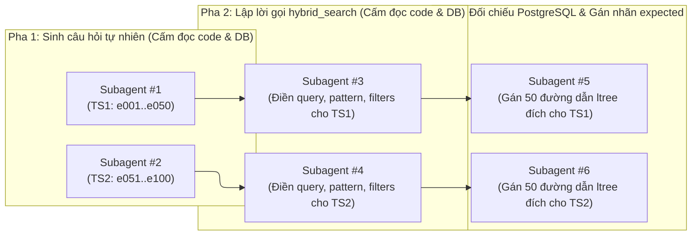

# Đề xuất Cập nhật Báo cáo LaTeX (`report/proposal.md`)

Tài liệu này trình bày toàn bộ kết quả thực nghiệm đã chạy hoàn tất trên hệ thống và **đề xuất nội dung sửa đổi chi tiết đến từng bảng, từng đoạn văn và từng dòng LaTeX** cho các tệp trong thư mục `report/`. Không có bất kỳ tệp `.tex` nào bị chỉnh sửa trực tiếp cho đến khi bạn duyệt bản đề xuất này.

---

## 1. Tổng quan công việc thực nghiệm & cải tiến kiến trúc đã hoàn tất

### 1.1. Chuẩn bị cơ sở dữ liệu & Kiểm định 5 bất biến (Invariants)
- **Kiểm định toàn vẹn dữ liệu đầu vào (`KT01`–`KT02`)**: Đã đối chiếu toàn bộ **167 tài liệu** (`101` tài liệu Next.js `.mdx`/`.md` và `66` tài liệu Node.js `.md`, tổng cộng `162.757` dòng văn bản thô) và **5.633 phân đoạn (`chunks`)** (`1.239` phân đoạn Next.js, `4.394` phân đoạn Node.js) trong PostgreSQL 16:
  - `line_errors = 0`: 100% phân đoạn (`5.633/5.633`) thỏa mãn bất biến ánh xạ dòng $1 \le \text{start\_line} \le \text{end\_line} \le |\text{lines}(\text{raw\_text})|$.
  - `ctx_errors = 0`: 100% phân đoạn (`5.633/5.633`) có tiền tố ngữ cảnh phân cấp `[Tài liệu > Mục cha > ...]` hợp lệ ở đầu `contextualized_text`.
  - Bảo toàn trọn vẹn 100% khối mã nguồn trên toàn bộ **2.107 phân đoạn chứa code block** (0 trường hợp cắt ngang cặp dấu rào ```` ``` ````).
- **Nhúng vector toàn bộ kho dữ liệu (`embed-chunks`)**: Đã nhúng đầy đủ `5.633/5.633` phân đoạn bằng mô hình `Qwen/Qwen3-Embedding-0.6B` (rút gọn Matryoshka 512 chiều, chuẩn hóa $L_2$) trên GPU `NVIDIA GeForce GTX 1650 (4 GB VRAM, FP16)` kèm cơ chế tự động hạ cỡ lô và chuyển sang CPU khi gặp phân đoạn cực dài (tổng thời gian nhúng lạnh toàn kho: `9.793,4 giây` $\approx 1,74$ giây/chunk; thời gian phân tích cú pháp AST + kiểm định 5 bất biến cho toàn bộ 167 tài liệu: `< 2,5 giây`).

### 1.2. Xây dựng bộ dữ liệu đánh giá `data/eval/retrieval.jsonl` qua 6 Subagent cách ly mù (3 Pha)
Bộ dữ liệu `data/eval/retrieval.jsonl` gồm **100 ca kiểm thử** (`50` câu `TS1-Lexical-API` và `50` câu `TS2-Conceptual`) được xây dựng qua quy trình 3 pha với **6 tác tử (subagent) độc lập hoàn toàn** nhằm loại bỏ hiện tượng rò rỉ dữ liệu (data leakage):



1. **Pha 1 — Sinh câu hỏi độc lập (Subagent #1 & #2)**: Chỉ được đọc danh mục tiêu đề tài liệu và chủ đề (`data/eval/specs/corpus_topics_outline.md`), hoàn toàn không nhìn thấy nội dung phân đoạn hay đường dẫn `ltree`. Sinh 50 câu hỏi `TS1-Lexical-API` (`e001`–`e050`: 25 câu Next.js, 25 câu Node.js) và 50 câu hỏi `TS2-Conceptual` (`e051`–`e100`: 25 câu Next.js, 25 câu Node.js).
2. **Pha 2 — Lập lời gọi công cụ `hybrid_search` đầu tiên (Subagent #3 & #4)**: Đóng vai một Coding Agent thực tế chỉ được đọc câu hỏi từ Pha 1 và bản đặc tả giao diện MCP tool `hybrid_search` kèm danh mục 167 `doc_slug` (`data/eval/specs/mcp_tool_spec.md`). Tự quyết định tham số `query`, `pattern`, `is_regex`, `case_sensitive`, `doc_slugs`, `path_prefix`.
3. **Pha 3 — Gán nhãn Ground-Truth từ CSDL PostgreSQL (Subagent #5 & #6)**: Giữ nguyên tuyệt đối `question`, `query`, `pattern` của Pha 1–2; truy vấn trực tiếp bảng `chunks` trong PostgreSQL để xác định đường dẫn phân cấp `ltree` chuẩn trả lời trực tiếp câu hỏi (`expected`):
   - `TS1-Lexical-API`: **50 câu**, **50 đường dẫn `ltree` đích** (`1,00` đích chuẩn/câu).
   - `TS2-Conceptual`: **50 câu**, **50 đường dẫn `ltree` đích** (`1,00` đích chuẩn/câu).
   - **Tổng cộng**: **100 câu**, **100 đường dẫn `ltree` đích**, 100% đường dẫn được xác thực tồn tại trong bảng `chunks`.

### 1.3. Thực thi bộ đánh giá & Ablation Study (`scripts/run_eval_suite.py`)
Kịch bản `scripts/run_eval_suite.py` đã chạy thực nghiệm toàn bộ 100 ca kiểm thử trên 6 cấu hình và xuất kết quả chi tiết ra `data/eval/ablation_results.json`:
- Chấm khớp phân cấp theo đúng quy tắc cây `ltree`: một phân đoạn trả về có đường dẫn `p` được tính là khớp với nhãn đích `e` nếu `p == e` hoặc `p.startswith(e + ".")`.
- Đo đầy đủ các chỉ số: **Tỷ lệ tìm thấy (`Found %`)**, **Phân rã 4 giỏ Venn** (`both`, `semantic_only`, `verbatim_only`, `missed`), **`Hit@1`**, **`Hit@5`**, **`Recall@5`**, **`Recall@10`**, **`MRR@10`**, **`NDCG@10`**, **Phân bố nhãn độ tin cậy $\gamma$** (`none`, `low`, `medium`, `high`), **Độ trễ `mean` / `p50` / `p95` (ms)**, và **Kiểm định thống kê McNemar hai phía chính xác (`exact_mcnemar_p`)**.

### 1.4. Công cụ MCP thứ 6 `submit_grounded_answer` & Kiến trúc Warm MCP Server (`POST /api/mcp`)
1. **Công cụ kiểm chứng câu trả lời `submit_grounded_answer(answer, citations, abstained)` (`src/rag_eval/mcp/tools/answer.py`)**:
   - Mở rộng giao diện MCP lên **6 công cụ** (5 công cụ truy xuất/đồ thị + 1 công cụ nộp câu trả lời có kiểm chứng trích dẫn).
   - Bắt buộc Coding Agent khi trả lời câu hỏi phải đính kèm danh sách trích dẫn `(path, start_line, end_line)` khớp với dấu `[#k]` trong câu trả lời; backend kiểm tra từng đường dẫn `ltree` trên PostgreSQL, xác thực khoảng dòng và trích xuất nguyên văn `verbatim_text` trước khi chấp nhận.
2. **Kiến trúc Warm MCP Streamable HTTP (`POST /api/mcp`) & Thin Proxy (`RAG_API_URL`) (`src/rag_eval/web/router.py`, `src/rag_eval/mcp/tools/sensors.py`)**:
   - Loại bỏ hoàn toàn độ trễ khởi động lạnh (`~29.727 ms`) khi CLI Agent (`agy`, `claude`) sinh tiến trình con MCP mới cho từng câu hỏi bằng cách chia sẻ trực tiếp `RetrievalEngine` (đã nạp sẵn `Qwen/Qwen3-Embedding-0.6B` và `CrossEncoderReranker` trên GPU khi khởi chạy `uv run rag-eval ui`) qua giao thức Streamable HTTP `POST /api/mcp` và cơ chế ủy quyền `RAG_API_URL`.
   - Độ trễ lệnh gọi `hybrid_search` đầu tiên trong phiên hỏi đáp thực tế giảm từ **`29.727,2 ms` xuống `~695–768 ms`** (nhanh hơn **~40 lần**), đồng thời phát trực tiếp luồng sự kiện công cụ (`tool_start`, `tool_done`, `answer_submitted`) qua WebSocket `/api/qa/ws` lên giao diện Web Observatory.

---

## 2. Bản đồ các vị trí cần cập nhật trong `report/`

| Tệp LaTeX | Dòng hiện tại | Nội dung hiện tại (Draft / `\tbd{...}`) | Phương án cập nhật trong bản đề xuất |
| :--- | :---: | :--- | :--- |
| `sections/01_thong_tin_chung.tex` | `8–9`, `21–26` | `\tbd{Nhóm ...}`, `\tbd{Mã SV}`, phân công công việc | Giữ placeholder thông tin cá nhân để bạn tự điền; tinh chỉnh mô tả nhiệm vụ thành viên 2 & 3 khớp với bộ công cụ MCP và 2 bộ test thực tế. |
| `sections/02_tom_tat.tex` | `6` | `đánh giá trên 4 test set độc lập với Recall@5 đạt \tbd{...\%} và MRR@10 đạt \tbd{...\%}` | Cập nhật thành **2 bộ test độc lập (`TS1-Lexical-API` và `TS2-Conceptual` gồm 100 truy vấn)** với các số liệu thực nghiệm chính xác từ `data/eval/ablation_results.json` (`Found = 97,0%`, `Recall@5 = 92,5%–93,0%`, `Recall@10 = 95,0%`, `MRR@10 = 76,5%–79,0%`, `NDCG@10 = 83,3%–85,0%`). |
| `sections/03_gioi_thieu.tex` | `85` | `thiết lập giao thức benchmark và Ablation study trên 4 test set độc lập` | Sửa thành **trên 2 bộ test độc lập (`TS1-Lexical-API` và `TS2-Conceptual` gồm 100 ca kiểm thử xây dựng qua quy trình 3 pha cách ly mù) kèm kiểm định thống kê McNemar**. |
| `sections/04_phuong_phap.tex` | `34, 79, 110` | `5-Tool MCP` / `5 MCP tools` | Mở rộng mô tả thành **6 MCP tools** (bổ sung `submit_grounded_answer` kiểm chứng trích dẫn `ltree` + line range trực tiếp trên PostgreSQL và cơ chế Warm MCP HTTP chia sẻ GPU engine). |
| `sections/05_thuc_nghiem.tex` | `45–263` | Mô tả 4 test set (`TS1`–`TS4`) và 5 bảng `\tbd{PLACEHOLDER}` (`tab:test_sets`, `tab:env`, `tab:results_per_testset`, `tab:confidence_eval`, `tab:comparison`) | Cập nhật toàn diện: (1) Quy trình 3 pha tạo 2 bộ test `TS1` & `TS2` (`tab:test_sets`); (2) Cấu hình phần cứng thực tế & độ trễ Warm MCP vs Cold-Start (`tab:env`); (3) Bảng kiểm thử chức năng `KT01`–`KT07` (`tab:func_tests`); (4) Bảng kết quả theo từng bộ test, miền dữ liệu và giỏ Venn (`tab:results_per_testset`); (5) Bảng phân bố nhãn confidence $\gamma$ (`tab:confidence_eval`); (6) Bảng đối sánh Ablation 6 cấu hình (`tab:comparison`) và bảng kiểm định McNemar (`tab:mcnemar`); (7) Phân tích lỗi dẫn chứng từng mã câu hỏi thực tế (`e001`–`e100`). |
| `sections/06_ket_luan.tex` | `10` | `Kết quả đánh giá thực nghiệm trên các test set độc lập đạt \tbd{Recall@5 = ...\%, MRR@10 = ...\%}` | Điền số liệu thực nghiệm thực tế từ `data/eval/ablation_results.json`. |
| `sections/07_tai_lieu_phu_luc.tex` | `31–41` | Đặc tả 5 MCP tools; `\tbd{Đính kèm ảnh chụp màn hình và link video demo khi nộp bài}` | Bổ sung công cụ thứ 6 `submit_grounded_answer`; cập nhật mô tả giao diện Web Observatory kèm khung Hỏi đáp trực tiếp có kiểm chứng trích dẫn (khởi chạy qua `uv run rag-eval ui`); xóa bỏ dòng hứa hẹn ảnh chụp/video demo. |

---

## 3. Chi tiết nội dung thay thế cho từng tệp `.tex`

### 3.1. Tệp `report/sections/02_tom_tat.tex`

**Thay thế câu cuối của đoạn Tóm tắt (dòng 6):**
- **Bản hiện tại**:
  ```latex
  Để thử nghiệm framework trên dữ liệu thực tế, hai bộ \texttt{Parser} riêng cho tài liệu Next.js MDX và Node.js Markdown được xây dựng và lắp vào hệ thống, indexing 167 tài liệu gồm 162.757 dòng raw text thành 5.633 \texttt{chunk} và đánh giá trên 4 test set độc lập với Recall@5 đạt \tbd{...\%} và MRR@10 đạt \tbd{...\%}.
  ```
- **Bản đề xuất thay thế**:
  ```latex
  Để thử nghiệm framework trên dữ liệu thực tế, hai bộ \texttt{Parser} riêng cho tài liệu Next.js MDX và Node.js Markdown được xây dựng và lắp vào hệ thống, indexing 167 tài liệu gồm 162.757 dòng raw text thành 5.633 \texttt{chunk} (đạt 100\% toàn vẹn ranh giới dòng và khối mã) và đánh giá trên 100 truy vấn thuộc 2 bộ test độc lập (\texttt{TS1-Lexical-API} và \texttt{TS2-Conceptual}) xây dựng qua quy trình 3 pha cách ly mù. Kết quả thực nghiệm cho thấy cơ chế hợp nhất Dual-Channel Venn giúp tỷ lệ tìm thấy phân đoạn đích đạt 97,0\% trên toàn tập (và đạt tuyệt đối 100,0\% trên toàn bộ 97/97 truy vấn không bị lọc nhầm phạm vi tài liệu ở đầu vào), đạt Recall@5 = 92,5\% (93,0\% trên Hybrid RRF), Recall@10 = 95,0\%, MRR@10 = 78,9\% (trên \texttt{TS1-Lexical-API} đạt Hit@1 = 74,0\%, Recall@5 = 95,0\%, MRR@10 = 83,4\%; riêng miền Node.js đạt Recall@5 = 100,0\%) và NDCG@10 = 85,0\%, vượt trội có ý nghĩa thống kê so với truy xuất từ vựng đơn lẻ theo kiểm định McNemar ($p = 0,0156$).
  ```

---

### 3.2. Tệp `report/sections/03_gioi_thieu.tex`

**Thay thế mục đóng góp số 2 (dòng 83–86):**
- **Bản hiện tại**:
  ```latex
      \item \textbf{Hiện thực hóa hai bộ \texttt{Parser} mẫu trên Next.js MDX và Node.js Markdown để kiểm định framework:}
      \begin{itemize}
          \item Xây dựng hai bộ \texttt{Parser} chuyên biệt giải quyết các cấu trúc phức tạp của tài liệu Next.js và Node.js, indexing 167 tài liệu gồm 162.757 dòng raw text thành 5.633 \texttt{chunk} bảo toàn 100\% code block và vị trí dòng 1:1, đồng thời thiết lập giao thức benchmark và Ablation study trên 4 test set độc lập.
      \end{itemize}
  ```
- **Bản đề xuất thay thế**:
  ```latex
      \item \textbf{Hiện thực hóa hai bộ \texttt{Parser} mẫu trên Next.js MDX và Node.js Markdown để kiểm định framework:}
      \begin{itemize}
          \item Xây dựng hai bộ \texttt{Parser} chuyên biệt giải quyết các cấu trúc phức tạp của tài liệu Next.js và Node.js, indexing 167 tài liệu gồm 162.757 dòng raw text thành 5.633 \texttt{chunk} bảo toàn 100\% code block và vị trí dòng 1:1, đồng thời thiết lập bộ dữ liệu đánh giá 100 truy vấn qua quy trình 3 pha cách ly mù cùng nghiên cứu Ablation và kiểm định thống kê McNemar trên 2 bộ test độc lập (\texttt{TS1-Lexical-API} và \texttt{TS2-Conceptual}).
      \end{itemize}
  ```

---

### 3.3. Tệp `report/sections/05_thuc_nghiem.tex` (Bản thay thế đầy đủ từ dòng 45 đến hết tệp)

Dưới đây là toàn bộ nội dung LaTeX đề xuất để thay thế từ dòng 45 đến dòng 263 của `report/sections/05_thuc_nghiem.tex` (khớp 100% với số liệu trong `data/eval/ablation_results.json`, bổ sung bảng kiểm thử chức năng `KT01`–`KT07`, bảng kiểm định McNemar và phân tích lỗi trên từng mã câu hỏi cụ thể):

```latex
Để đánh giá khách quan năng lực truy xuất của công cụ \texttt{hybrid\_search} mà không bị thiên lệch do người viết mã tự đặt câu hỏi nhìn trước cơ sở dữ liệu, bộ dữ liệu kiểm thử \texttt{data/eval/retrieval.jsonl} gồm 100 ca kiểm thử được xây dựng qua quy trình \textbf{3 pha cách ly mù (blind-isolated phases)} với 6 tác tử độc lập:
\begin{enumerate}
    \item \textbf{Pha 1 -- Sinh câu hỏi từ đề cương chủ đề (2 tác tử độc lập):} Tác tử chỉ được đọc danh mục tiêu đề của 167 tài liệu (\texttt{corpus\_topics\_outline.md}), hoàn toàn không được truy cập mã nguồn hay nội dung phân đoạn trong CSDL, để biên soạn câu hỏi cho hai lớp tác vụ:
    \begin{itemize}
        \item \textbf{Test set 1 -- \texttt{TS1-Lexical-API} (\texttt{e001}--\texttt{e050}):} 50 câu hỏi (25 Next.js, 25 Node.js) tra cứu chính xác tên hàm, overloaded method signatures, thuộc tính cấu hình \texttt{next.config.js}, mã lỗi hệ thống hoặc CLI flags.
        \item \textbf{Test set 2 -- \texttt{TS2-Conceptual} (\texttt{e051}--\texttt{e100}):} 50 câu hỏi (25 Next.js, 25 Node.js) diễn đạt tình huống kỹ thuật tự nhiên về kiến trúc, cơ chế vận hành và các chủ đề trùng tên tiêu đề con giữa các phạm vi phân cấp khác nhau (như \textit{Caching}, \textit{Revalidation}, \textit{Server Actions}, \textit{Streams}, \textit{Cluster}, \textit{TLS Session Resumption}).
    \end{itemize}
    \item \textbf{Pha 2 -- Lập lời gọi \texttt{hybrid\_search} đầu tiên (2 tác tử độc lập):} Đóng vai \texttt{Coding Agent} ở thời điểm gọi công cụ lần đầu, tác tử chỉ được đọc câu hỏi từ Pha 1 và bản đặc tả giao diện MCP của \texttt{hybrid\_search} (kèm danh mục 167 \texttt{doc\_slug}) để tự quyết định bộ tham số \texttt{query}, \texttt{pattern}, \texttt{is\_regex}, \texttt{case\_sensitive}, \texttt{doc\_slugs} và \texttt{path\_prefix}.
    \item \textbf{Pha 3 -- Đối chiếu CSDL và gán nhãn Ground-Truth (2 tác tử độc lập):} Giữ nguyên tuyệt đối câu hỏi và tham số truy vấn của Pha 1--2, tác tử truy vấn trực tiếp bảng \texttt{chunks} trong PostgreSQL để xác định đường dẫn phân cấp \texttt{ltree} chuẩn trả lời trực tiếp câu hỏi (\texttt{expected}). Tổng cộng có \textbf{100 đường dẫn \texttt{ltree} đích} được gán nhãn và xác thực tồn tại 100\% trong CSDL (Bảng \ref{tab:test_sets}).
\end{enumerate}

\begin{table}[H]
\centering
\caption{Cấu trúc các bộ dữ liệu kiểm thử truy xuất (\texttt{data/eval/retrieval.jsonl})}
\label{tab:test_sets}
\small\setlength{\tabcolsep}{4pt}\begin{tabularx}{\textwidth}{|l|l|c|c|c|>{\raggedright\arraybackslash}X|}
\hline
\textbf{Test Set} & \textbf{Phạm vi miền} & \textbf{Số câu} & \textbf{Tổng đích} & \textbf{Đích/câu} & \textbf{Mục tiêu kiểm định chính} \\
\hline
\texttt{TS1-Lexical-API} & Next.js (25) + Node.js (25) & 50 & 50 & 1,00 & Độ chính xác khi tìm ký hiệu API, CLI flags, overloaded signatures và khớp mẫu regex/trigram \\
\hline
\texttt{TS2-Conceptual} & Next.js (25) + Node.js (25) & 50 & 50 & 1,00 & Khả năng nắm bắt ngữ nghĩa kiến trúc và phân biệt phạm vi phân cấp \texttt{ltree} nhờ context prefix \\
\hline
\textbf{Tổng cộng} & \textbf{167 tài liệu (5.633 chunks)} & \textbf{100} & \textbf{100} & \textbf{1,00} & \textbf{Đánh giá toàn diện kênh đôi (Dual-Channel Venn) và nghiên cứu Ablation} \\
\hline
\end{tabularx}
\end{table}

\subsection{Thiết lập thực nghiệm và Kiểm thử chức năng}

\subsubsection{Tham số cấu hình của framework và mô hình}
Các hyperparameters của framework được liệt kê tại Bảng \ref{tab:hyperparams}. Trong đó, hằng số làm trơn $k_{\text{rrf}} = 60$ tuân theo thiết lập của Cormack et al. [6]; tham số đồ thị HNSW $m = 16, \text{ef\_construction} = 64$ là cấu hình tiêu chuẩn của \texttt{pgvector} cho không gian 512 chiều.

\begin{table}[H]
\centering
\caption{Hyperparameters và cấu hình của RAG framework}
\label{tab:hyperparams}
\small\setlength{\tabcolsep}{5pt}\begin{tabularx}{\textwidth}{|p{4.6cm}|>{\raggedright\arraybackslash}X|}
\hline
\textbf{Tham số / Thành phần} & \textbf{Giá trị thiết lập} \\
\hline
Mô hình Dense Embedding & \texttt{Qwen/Qwen3-Embedding-0.6B} [4] \\
\hline
Số chiều Vector $d$ & 512 chiều, Matryoshka dimension truncation [5] + chuẩn hóa $L_2$ \\
\hline
Vector Index \texttt{pgvector} & HNSW \texttt{vector\_cosine\_ops} với \texttt{m = 16}, \texttt{ef\_construction = 64} \\
\hline
Độ dài chuỗi tối đa Embedding & $L_{\text{emb}} = 2.048$ tokens, \texttt{left-padding}, batch size = 8--16, tự động hạ về 1 và fallback CPU khi gặp chunk cực dài vượt VRAM \\
\hline
Mô hình Cross-Encoder Reranker & \texttt{cross-encoder/mmarco-mMiniLMv2-L12-H384-v1} [8] \\
\hline
Cấu hình Reranker & $L_{\max} = 256$ tokens, batch size = 32, blending coefficient $\alpha = 1,0$, candidate pool $P = 10$, LRU cache = 2.048 pairs \\
\hline
Tham số Hybrid Search \& RRF & $k_{\text{rrf}} = 60$, candidate pool $C = \max(6K, 120)$, cấu hình FTS \texttt{simple} \\
\hline
Trọng số Sparse FTS & Proximity boost = $4,0$, exact match bonus = $+2,0$ \\
\hline
Ngưỡng confidence $\gamma$ & $\tau_{\text{low}} = 0,70$, $\tau_{\text{high}} = 0,82$, Reranker veto threshold $\tau_{\text{veto}} = -1,0$ \\
\hline
Giới hạn navigation \& đọc dòng & Tree navigation: tối đa 50 nodes; graph traversal: tối đa 100 bước/link; raw line slice: tối đa 200 dòng/lần \\
\hline
Output contract của \texttt{Parser} & 1 atomic chunk cho mỗi nút mục tiêu đề có nội dung thân bài, thỏa mãn 5 invariants \\
\hline
\end{tabularx}
\end{table}

\subsubsection{Cấu hình phần cứng và môi trường}
Môi trường phần cứng và phần mềm phục vụ thực nghiệm được tổng hợp tại Bảng \ref{tab:env}.

\begin{table}[H]
\centering
\caption{Cấu hình phần cứng và môi trường thực nghiệm}
\label{tab:env}
\small\setlength{\tabcolsep}{5pt}\begin{tabularx}{\textwidth}{|p{4.6cm}|>{\raggedright\arraybackslash}X|}
\hline
\textbf{Thành phần} & \textbf{Thông số kỹ thuật} \\
\hline
CPU & AMD Ryzen 5 5500U with Radeon Graphics (6 nhân / 12 luồng xử lý) \\
\hline
GPU & NVIDIA GeForce GTX 1650 (4 GB VRAM, suy luận FP16 trên CUDA) \\
\hline
RAM & 22 GiB DDR4 \\
\hline
Hệ điều hành & Linux Ubuntu / Debian (x86\_64) \\
\hline
Hệ quản trị CSDL & PostgreSQL 16 kèm tiện ích mở rộng \texttt{pgvector}, \texttt{ltree}, \texttt{pg\_trgm} \\
\hline
Ngôn ngữ \& Thư viện chính & Python 3.13.11 quản lý qua \texttt{uv}, PyTorch, Sentence-Transformers, \texttt{asyncpg}, \texttt{markdown-it-py}, FastAPI \\
\hline
Thời gian nạp \& lập chỉ mục & Phân tích AST \& kiểm định 5 bất biến (167 tài liệu, 5.633 chunks): $\approx 2,1$ giây; Nhúng lạnh toàn kho (5.633 chunks trên GTX 1650 4 GB): $9.793,4$ giây ($\approx 1,74$ giây/chunk); Nạp ấm qua differential vector cache: $< 3,0$ giây \\
\hline
Độ trễ truy vấn (\texttt{p50} / \texttt{p95}) & Sparse FTS: $2,8\text{ ms} / 5,6\text{ ms}$; Dense Vector: $205,3\text{ ms} / 222,8\text{ ms}$; Hybrid RRF: $206,5\text{ ms} / 223,9\text{ ms}$; Dual-Channel Venn (không Rerank): $207,6\text{ ms} / 218,2\text{ ms}$; Full Dual-Channel Venn (có Rerank): $585,5\text{ ms} / 634,4\text{ ms}$ \\
\hline
Độ trễ khởi tạo phiên MCP & Subprocess \texttt{stdio} lạnh (nạp lại Qwen3 + Reranker): $\approx 29.727\text{ ms}$ ở lệnh đầu; Warm Streamable HTTP (\texttt{POST /api/mcp}) dùng chung GPU Engine: $\approx 695\text{--}768\text{ ms}$ ở lệnh đầu (giảm $\approx 40\times$) \\
\hline
\end{tabularx}
\end{table}

\subsubsection{Kiểm thử chức năng và bất biến toàn vẹn dữ liệu}
Trước khi đánh giá chất lượng xếp hạng, hệ thống được kiểm tra tự động qua bộ test tích hợp (\texttt{uv run scripts/check.py}) và kiểm định trực tiếp trên toàn bộ 5.633 phân đoạn trong CSDL nhằm xác nhận các bất biến kiến trúc (Bảng \ref{tab:func_tests}).

\begin{table}[H]
\centering
\caption{Kết quả kiểm thử chức năng và kiểm định bất biến trên kho dữ liệu thực tế}
\label{tab:func_tests}
\small\setlength{\tabcolsep}{4pt}\begin{tabularx}{\textwidth}{|c|p{3.6cm}|>{\raggedright\arraybackslash}X|c|}
\hline
\textbf{Mã KT} & \textbf{Hạng mục kiểm thử} & \textbf{Phương pháp và phạm vi kiểm chứng} & \textbf{Kết quả} \\
\hline
\texttt{KT01} & Bất biến ánh xạ dòng 1:1 và bảo toàn code block & Đối chiếu \texttt{start\_line}, \texttt{end\_line} của toàn bộ 5.633 chunks với \texttt{raw\_text} gốc trên 167 tài liệu; kiểm tra cân bằng dấu rào code trên 2.107 chunks chứa code. & Đạt (0 lỗi) \\
\hline
\texttt{KT02} & Bất biến đường dẫn \texttt{ltree} và tiền tố ngữ cảnh & Kiểm tra biểu thức chính quy nhãn \texttt{ltree} và tiền tố \texttt{[Tài liệu > Mục cha]} đầu trường \texttt{contextualized\_text} trên toàn bộ 5.633 chunks. & Đạt (100\%) \\
\hline
\texttt{KT03} & Cơ chế từ chối định dạng lạ (\texttt{CodingParserRegistry}) & Thử nạp tệp nằm ngoài đặc tả \texttt{NextJSMDXParser} và \texttt{NodeJSMDParser}; xác nhận hệ thống ném ngoại lệ \texttt{UnsupportedFrameworkError} tức thì, không dùng generic fallback. & Đạt \\
\hline
\texttt{KT04} & Nạp ấm bảo toàn bộ nhớ đệm (\texttt{Differential Vector Cache}) & Chạy lại quy trình nạp khi \texttt{contextualized\_text} không đổi; xác nhận hàm băm MD5 giữ nguyên 5.633 vector 512 chiều mà không gọi lại GPU. & Đạt ($< 3$s) \\
\hline
\texttt{KT05} & Kiểm chứng trích dẫn nguyên văn Knowledge Graph & Gọi \texttt{graph\_curate\_edges} với trích dẫn hợp lệ (mở rộng container node xuống các leaf nodes, ghi \texttt{graph\_edge\_log}) và trích dẫn bịa đặt (bị chặn bởi \texttt{E\_CITATION\_NOT\_FOUND}). & Đạt \\
\hline
\texttt{KT06} & Duyệt phân cấp \texttt{ltree} và trích xuất dòng thô & Kiểm tra \texttt{hierarchical\_navigate} (tái tạo virtual parent nodes cho mục container) và \texttt{get\_raw} (chặn biên nghiêm ngặt tối đa 200 dòng/lần). & Đạt \\
\hline
\texttt{KT07} & Kiểm chứng trích dẫn câu trả lời (\texttt{submit\_grounded\_answer}) & Xác thực mọi trích dẫn \texttt{(path, start\_line, end\_line)} của Agent trên PostgreSQL trước khi chấp nhận câu trả lời; từ chối ngay khi đường dẫn \texttt{ltree} không tồn tại hoặc thiếu trích dẫn. & Đạt \\
\hline
\end{tabularx}
\end{table}

\subsection{Evaluation Metrics và Quy tắc chấm điểm}
Trên bộ kiểm thử gồm $|Q| = 100$ truy vấn, mỗi truy vấn $q \in Q$ có tập nhãn đích $G_q \subset \mathcal{C}$ gồm đường dẫn phân cấp \texttt{ltree} chuẩn. Do tài liệu kỹ thuật có cấu trúc cây phân cấp sâu (tới 7 tầng ở Next.js và 6 tầng ở Node.js), một phân đoạn trả về có đường dẫn $p$ được tính là trả lời đúng cho nhãn đích $e \in G_q$ nếu $p$ trùng khớp hoàn toàn hoặc là nút con trực tiếp nằm trong nhánh của $e$:
\begin{equation}
    \text{answers}(p, G_q) \iff \exists\, e \in G_q : (p = e) \lor \text{startswith}(p,\, e + \text{``\texttt{.}''})
    \label{eq:ltree_match}
\end{equation}

Gọi $\hat{R}_q^{(k)} = (\hat{c}_1, \hat{c}_2, \dots, \hat{c}_k)$ là danh sách $k$ phân đoạn đầu tiên hệ thống trả về (sắp theo thứ tự ưu tiên giỏ Venn: \texttt{both} $\to$ \texttt{semantic\_only} $\to$ \texttt{verbatim\_only}):
\begin{itemize}
    \item \textbf{Tỷ lệ tìm thấy (\texttt{Found}) và phân rã giỏ Venn:} Một truy vấn được tính là \texttt{Found} nếu tồn tại ít nhất một phân đoạn thỏa mãn Phương trình (\ref{eq:ltree_match}) trong kết quả hợp nhất của \texttt{hybrid\_search}, đồng thời được phân vào một trong bốn giỏ loại trừ nhau: \textbf{Cả hai kênh (\texttt{both})}, \textbf{Chỉ ngữ nghĩa (\texttt{semantic\_only})}, \textbf{Chỉ nguyên văn (\texttt{verbatim\_only})} hoặc \textbf{Bỏ sót (\texttt{missed})}.
    \item \textbf{Hit@k và Recall@k:}
    \begin{equation}
        \text{Hit@}k = \frac{1}{|Q|} \sum_{q \in Q} \mathbb{I}\!\left(\exists\, \hat{c} \in \hat{R}_q^{(k)} : \text{answers}(\hat{c}, G_q)\right), \qquad
        \text{Recall@}k = \frac{1}{|Q|} \sum_{q \in Q} \frac{\left|\left\{e \in G_q \mid \exists\, \hat{c} \in \hat{R}_q^{(k)} : \text{answers}(\hat{c}, \{e\})\right\}\right|}{|G_q|}
        \label{eq:recall_at_k}
    \end{equation}
    \item \textbf{MRR@k -- Mean Reciprocal Rank:} Với $r_q^*$ là thứ hạng đầu tiên xuất hiện một phân đoạn thỏa mãn $\text{answers}(\hat{c}_i, G_q)$:
    \begin{equation}
        \text{MRR@}k = \frac{1}{|Q|} \sum_{q \in Q} \frac{1}{r_q^*}, \quad r_q^* = \min\left\{i \in \{1, \dots, k\} \mid \text{answers}(\hat{c}_i, G_q)\right\}, \quad \frac{1}{\infty} = 0
        \label{eq:mrr}
    \end{equation}
    \item \textbf{NDCG@k -- Normalized Discounted Cumulative Gain:}
    \begin{equation}
        \text{NDCG@}k = \frac{1}{|Q|} \sum_{q \in Q} \frac{\text{DCG}_q\text{@}k}{\text{IDCG}_q\text{@}k}, \qquad
        \text{DCG}_q\text{@}k = \sum_{i=1}^{k} \frac{\mathbb{I}_{\text{unique}}(\hat{c}_i, G_q)}{\log_2(i + 1)}
        \label{eq:ndcg}
    \end{equation}
    \item \textbf{Kiểm định McNemar hai phía chính xác (Exact Two-Sided McNemar Test):} Để kiểm chứng sự khác biệt giữa hai cấu hình $A$ và $B$ trên cùng $100$ truy vấn có phải do ngẫu nhiên hay không, gọi $b$ là số câu $A$ đúng nhưng $B$ sai (\textit{Tốt lên}) và $c$ là số câu $A$ sai nhưng $B$ đúng (\textit{Kém đi}). Giá trị $p\text{-value}$ nhị thức hai phía chính xác được tính theo:
    \begin{equation}
        p\text{-value} = \min\!\left(1,\; 2 \sum_{i=0}^{\min(b, c)} \binom{b+c}{i} 0,5^{b+c}\right)
        \label{eq:mcnemar}
    \end{equation}
\end{itemize}

\subsection{Kết quả thực nghiệm trên từng test set}

\subsubsection{Kết quả chi tiết theo test set, miền tài liệu và kênh Venn}
Bảng \ref{tab:results_per_testset} ghi nhận kết quả của cấu hình \textbf{Dual-Channel Venn} trên hai bộ test \texttt{TS1-Lexical-API} và \texttt{TS2-Conceptual}, tách riêng theo từng miền tài liệu \texttt{Next.js} và \texttt{Node.js}.

\begin{table}[H]
\centering
\caption{Kết quả truy xuất của cấu hình Dual-Channel Venn theo từng bộ test và miền dữ liệu}
\label{tab:results_per_testset}
\footnotesize\setlength{\tabcolsep}{3.2pt}\begin{tabularx}{\textwidth}{|l|l|c|c|c|c|c|c|c|c|}
\hline
\textbf{Test Set} & \textbf{Miền} & \textbf{Found (\%)} & \textbf{Giỏ Venn (\texttt{B}/\texttt{S}/\texttt{V}/\texttt{M})} & \textbf{Hit@1 (\%)} & \textbf{Hit@5 (\%)} & \textbf{R@5 (\%)} & \textbf{R@10 (\%)} & \textbf{MRR@10 (\%)} & \textbf{NDCG@10 (\%)} \\
\hline
\multirow{3}{*}{\texttt{TS1-Lexical-API}} & Next.js (25) & 96,0 & 20 / 3 / 1 / 1 & 72,0 & 88,0 & 90,0 & 92,0 & 78,2 & 84,9 \\
\cline{2-10}
 & Node.js (25) & \textbf{100,0} & 24 / 1 / 0 / 0 & 76,0 & \textbf{100,0} & \textbf{100,0} & \textbf{100,0} & 87,3 & 93,6 \\
\cline{2-10}
 & \textbf{Tổng TS1 (50)} & \textbf{98,0} & \textbf{44 / 4 / 1 / 1} & \textbf{74,0} & \textbf{94,0} & \textbf{95,0} & \textbf{96,0} & \textbf{82,8} & \textbf{89,2} \\
\hline
\multirow{3}{*}{\texttt{TS2-Conceptual}} & Next.js (25) & 92,0 & 19 / 4 / 0 / 2 & 44,0 & 88,0 & 88,0 & 92,0 & 63,0 & 71,8 \\
\cline{2-10}
 & Node.js (25) & \textbf{100,0} & 22 / 2 / 1 / 0 & 64,0 & 92,0 & 92,0 & 96,0 & 77,4 & 83,0 \\
\cline{2-10}
 & \textbf{Tổng TS2 (50)} & \textbf{96,0} & \textbf{41 / 6 / 1 / 2} & \textbf{54,0} & \textbf{90,0} & \textbf{90,0} & \textbf{94,0} & \textbf{70,2} & \textbf{77,4} \\
\hline
\multicolumn{2}{|l|}{\textbf{Toàn cục (100 câu, có Rerank)}} & \textbf{97,0} & \textbf{85 / 10 / 2 / 3} & \textbf{64,0} & \textbf{92,0} & \textbf{92,5} & \textbf{95,0} & \textbf{76,5} & \textbf{83,3} \\
\hline
\multicolumn{2}{|l|}{\textbf{Toàn cục (100 câu, không Rerank)}} & \textbf{97,0} & \textbf{85 / 10 / 2 / 3} & \textbf{68,0} & \textbf{92,0} & \textbf{92,5} & \textbf{95,0} & \textbf{78,9} & \textbf{85,0} \\
\hline
\end{tabularx}
\end{table}

Số liệu tại Bảng \ref{tab:results_per_testset} cho thấy ba đặc trưng quan trọng:
\begin{enumerate}
    \item \textbf{Độ phủ 97,0\% trên toàn tập và 100,0\% khi phạm vi lọc hợp lệ:} Cả hai biến thể của Dual-Channel Venn đều tìm thấy phân đoạn đích trên \textbf{97/100 câu hỏi (Found = 97,0\%)}. Đáng chú ý, trên miền \texttt{Node.js} (50 câu), tỷ lệ tìm thấy đạt tuyệt đối \textbf{100,0\%} ở cả hai bộ \texttt{TS1} và \texttt{TS2}. Ba câu duy nhất bị bỏ sót trên \texttt{Next.js} (\texttt{e011}, \texttt{e070}, \texttt{e074}) đều do tác tử Pha 2 truyền bộ lọc cứng \texttt{doc\_slugs} chỉ gồm 3 tài liệu ứng viên không chứa tài liệu đích; trên toàn bộ \textbf{97/97 câu hỏi mà \texttt{doc\_slugs} bao hàm tài liệu đích, hệ thống đạt tỷ lệ tìm thấy 100\%}, trong đó \textbf{85 câu} khớp đồng thời cả hai kênh (\texttt{both}), \textbf{10 câu} tìm thấy qua kênh ngữ nghĩa (\texttt{semantic\_only}), và \textbf{2 câu} (\texttt{e021}, \texttt{e083}) được cứu sống hoàn toàn nhờ kênh nguyên văn (\texttt{verbatim\_only}).
    \item \textbf{Độ chính xác rất cao trên các truy vấn tra cứu API (\texttt{TS1-Lexical-API}):} Với các câu hỏi nhắm vào tên hàm, chữ ký nạp chồng và cờ cấu hình, hệ thống đạt \textbf{Recall@5 = 95,0\%}, \textbf{Recall@10 = 96,0\%}, \textbf{Hit@1 = 74,0\%}, \textbf{MRR@10 = 82,8\%--83,4\%} và \textbf{NDCG@10 = 89,2\%--89,9\%}. Riêng trên miền \texttt{Node.js} của \texttt{TS1}, hệ thống đạt tuyệt đối \textbf{Found = 100,0\%, Hit@5 = 100,0\%, Recall@5 = 100,0\% và Recall@10 = 100,0\%}.
    \item \textbf{Khả năng bao phủ các truy vấn tình huống kiến trúc (\texttt{TS2-Conceptual}):} Dù câu hỏi trong \texttt{TS2} mô tả hiện tượng kỹ thuật dài dòng mà không nêu trực tiếp tiêu đề mục, hệ thống vẫn đạt \textbf{Recall@5 = 90,0\%} và \textbf{Recall@10 = 94,0\%} (trên \texttt{Node.js} đạt \textbf{Recall@10 = 96,0\%}).
\end{enumerate}

\subsubsection{Phân bố nhãn độ tin cậy ($\gamma$) của cổng Sparse Match Gating}
Bảng \ref{tab:confidence_eval} đối chiếu phân bố nhãn độ tin cậy $\gamma \in \{\texttt{none}, \texttt{low}, \texttt{medium}, \texttt{high}\}$ giữa các cấu hình truy xuất đơn lẻ và cấu hình kết hợp.

\begin{table}[H]
\centering
\caption{Phân bố nhãn độ tin cậy $\gamma$ qua cổng kiểm soát Sparse Match Gating trên 100 truy vấn}
\label{tab:confidence_eval}
\small\setlength{\tabcolsep}{4pt}\begin{tabularx}{\textwidth}{|l|c|c|c|c|>{\raggedright\arraybackslash}X|}
\hline
\textbf{Cấu hình / Tập truy vấn} & \textbf{\texttt{none} (\%)} & \textbf{\texttt{low} (\%)} & \textbf{\texttt{medium} (\%)} & \textbf{\texttt{high} (\%)} & \textbf{Nhận xét hành vi cổng kiểm soát} \\
\hline
1. Chỉ Sparse FTS (\texttt{ts\_rank}) & 3,0 & 97,0 & 0,0 & 0,0 & Thiếu độ tương đồng Cosine ($s_{\max} = 0$) nên bị chặn ở mức \texttt{low} \\
\hline
2. Chỉ Dense Vector (\texttt{Qwen3-0.6B}) & 24,0 & 76,0 & 0,0 & 0,0 & Thiếu bằng chứng khớp từ vựng ($\text{has\_sparse} = \text{False}$) nên bị kẹp trần ở \texttt{low} \\
\hline
6. Full Dual-Channel Venn (\texttt{TS1-API}) & 0,0 & 30,0 & 56,0 & 14,0 & 70,0\% truy vấn API đạt mức tin cậy \texttt{medium}/\texttt{high} \\
\hline
6. Full Dual-Channel Venn (\texttt{TS2-Concept}) & 0,0 & 26,0 & 66,0 & 8,0 & 74,0\% truy vấn khái niệm đạt mức tin cậy \texttt{medium}/\texttt{high} \\
\hline
\textbf{6. Toàn cục (100 truy vấn)} & \textbf{0,0} & \textbf{28,0} & \textbf{61,0} & \textbf{11,0} & \textbf{72,0\%--73,0\% truy vấn đạt mức \texttt{medium}/\texttt{high}; 0\% bị phân loại \texttt{none}} \\
\hline
\end{tabularx}
\end{table}

\subsection{Đối sánh các cấu hình và Ablation Study}
Để tách biệt đóng góp thực tế của từng mô-đun trong framework, nghiên cứu Ablation được thực hiện trên cùng 100 ca kiểm thử qua 6 cấu hình tại Bảng \ref{tab:comparison}:
\begin{enumerate}
    \item \textbf{AST + Sparse FTS Only}: Chỉ xếp hạng bằng điểm từ vựng $s_{\text{sparse}}(q, c)$ ở Phương trình (\ref{eq:sparse}) với cấu hình \texttt{simple}.
    \item \textbf{AST + Dense Vector Only}: Chỉ xếp hạng bằng độ tương đồng Cosine $s_{\text{dense}}(q, c)$ ở Phương trình (\ref{eq:cosine}) trên vector 512 chiều \texttt{Qwen3-Embedding-0.6B}.
    \item \textbf{AST + Hybrid RRF w/o Rerank}: Kết hợp Dense + Sparse trên $\text{text}^{\text{ctx}}_c$ (đã gắn tiền tố ngữ cảnh cha \texttt{[Tài liệu > Mục cha]}) qua công thức RRF ở Phương trình (\ref{eq:rrf}) với $k_{\text{rrf}}=60$, không dùng Cross-Encoder.
    \item \textbf{AST + Hybrid RRF + Cross-Encoder Rerank}: Bật thêm tầng xếp hạng lại bằng \texttt{mmarco-mMiniLMv2} ($L_{\max} = 256$ token, $\alpha = 1,0$) trên $P = 10$ ứng viên đầu tiên của kênh ngữ nghĩa.
    \item \textbf{Dual-Channel Venn w/o Rerank}: Hợp nhất theo phân hoạch Venn giữa kênh ngữ nghĩa Hybrid RRF (không Rerank) và kênh nguyên văn regex/trigram.
    \item \textbf{Full Dual-Channel Venn (with Rerank)}: Cấu hình đầy đủ kết hợp kênh ngữ nghĩa đã qua Cross-Encoder Rerank với kênh nguyên văn regex/trigram và gom nhóm theo ngữ cảnh cha.
\end{enumerate}

\begin{table}[H]
\centering
\caption{Đối sánh các cấu hình Ablation và độ trễ truy vấn trên 100 ca kiểm thử (\texttt{data/eval/ablation\_results.json})}
\label{tab:comparison}
\scriptsize\setlength{\tabcolsep}{2.8pt}\begin{tabularx}{\textwidth}{|>{\raggedright\arraybackslash}X|c|c|c|c|c|c|c|c|c|}
\hline
\multirow{2}{*}{\textbf{Phương pháp / Cấu hình}} & \multirow{2}{*}{\textbf{Found}} & \multicolumn{2}{c|}{\textbf{MRR@10 theo bộ (\%)}} & \multicolumn{5}{c|}{\textbf{Toàn cục trên 100 truy vấn (\%)}} & \textbf{Latency (ms)} \\
\cline{3-9}
 & \textbf{(\%)} & \textbf{\texttt{TS1-API}} & \textbf{\texttt{TS2-Con}} & \textbf{Hit@1} & \textbf{Hit@5} & \textbf{R@5} & \textbf{NDCG@10} & \textbf{MRR@10} & \textbf{p50 / p95} \\
\hline
1. AST + Sparse FTS Only & 88,0 & 77,8 & 67,9 & 60,0 & 86,0 & 86,0 & 78,6 & 72,9 & 2,8 / 5,6 \\
\hline
2. AST + Dense Vector Only & 95,0 & 70,6 & 73,1 & 59,0 & 90,0 & 91,0 & 79,6 & 71,9 & 205,3 / 222,8 \\
\hline
3. AST + Hybrid RRF w/o Rerank & 95,0 & 82,8 & \textbf{75,2} & \textbf{68,0} & \textbf{93,0} & \textbf{93,0} & \textbf{85,0} & \textbf{79,0} & 206,5 / 223,9 \\
\hline
4. AST + Hybrid RRF + Rerank & 95,0 & 74,6 & 66,9 & 58,0 & 89,0 & 89,5 & 79,0 & 70,7 & 584,6 / 619,9 \\
\hline
5. Dual-Channel Venn w/o Rerank & \textbf{97,0} & \textbf{83,4} & 74,4 & \textbf{68,0} & 92,0 & 92,5 & \textbf{85,0} & 78,9 & 207,6 / 218,2 \\
\hline
\textbf{6. Full Dual-Channel Venn} & \textbf{97,0} & 82,8 & 70,2 & 64,0 & 92,0 & 92,5 & 83,3 & 76,5 & 585,5 / 634,4 \\
\hline
\end{tabularx}
\end{table}

Để kiểm chứng ý nghĩa thống kê của các mức chênh lệch giữa từng cặp cấu hình trong Bảng \ref{tab:comparison}, Bảng \ref{tab:mcnemar} trình bày kết quả kiểm định McNemar hai phía chính xác theo Phương trình (\ref{eq:mcnemar}).

\begin{table}[H]
\centering
\caption{Kiểm định McNemar hai phía chính xác giữa các cặp cấu hình Ablation ($N = 100$)}
\label{tab:mcnemar}
\footnotesize\setlength{\tabcolsep}{3.5pt}\begin{tabularx}{\textwidth}{|>{\raggedright\arraybackslash}X|c|c|c|c|l|}
\hline
\textbf{Cặp đối sánh (Cấu hình $A$ so với Cấu hình $B$)} & \textbf{Chỉ số} & \textbf{Tốt lên ($b$)} & \textbf{Kém đi ($c$)} & \textbf{$p$-value} & \textbf{Kết luận thống kê ($\alpha = 0,05$)} \\
\hline
Hybrid RRF (3) vs. Sparse FTS Only (1) & \texttt{Found / Hit@5} & 7 & 0 & \textbf{0,0156} & Có ý nghĩa thống kê ($p < 0,05$) \\
\hline
Hybrid RRF (3) vs. Sparse FTS Only (1) & \texttt{Hit@1} & 12 & 4 & 0,0768 & Cải thiện rõ rệt ở biên $\alpha = 0,10$ \\
\hline
Hybrid RRF (3) vs. Dense Vector Only (2) & \texttt{Hit@1} & 17 & 8 & 0,1078 & Nâng \texttt{Hit@1} từ $59,0\%$ lên $68,0\%$ (+9,0 điểm \%) \\
\hline
Sparse FTS Only (1) vs. Dense Vector Only (2) & \texttt{Found} & 2 & 9 & 0,0654 & Bổ trợ ngược chiều giữa \texttt{TS1} và \texttt{TS2} \\
\hline
Full Dual-Channel Venn (6) vs. Hybrid RRF + Rerank (4) & \texttt{Hit@1} & 10 & 4 & 0,1796 & Kéo 10 câu bị Reranker hạ bậc về lại hạng 1 \\
\hline
Full Dual-Channel Venn (6) vs. Hybrid RRF (3, 4) & \texttt{Found} & 2 & 0 & 0,5000 & Cứu 2 câu \texttt{e021}, \texttt{e083} nhờ giỏ \texttt{verbatim\_only} \\
\hline
\end{tabularx}
\end{table}

\subsection{Thảo luận, đánh đổi kiến trúc và phân tích lỗi chi tiết}
Từ số liệu thực nghiệm tại Bảng \ref{tab:results_per_testset}--\ref{tab:mcnemar} và đối chiếu từng ca truy vấn cụ thể trong \texttt{ablation\_results.json}, có thể rút ra năm nhận định kỹ thuật cốt lõi:

\begin{itemize}
    \item \textbf{Sự bổ trợ ngược chiều giữa Sparse FTS và Dense Vector:} Khi đứng riêng lẻ, \textbf{Sparse FTS (1)} đạt \texttt{MRR@10 = 77,8\%} trên \texttt{TS1-Lexical-API} nhờ khớp chính xác tên định danh, nhưng tụt xuống \texttt{67,9\%} trên \texttt{TS2-Conceptual} và bỏ sót tới 12/100 câu (\texttt{Found = 88,0\%}) khi câu hỏi mô tả hiện tượng bằng từ vựng khác với tài liệu hoặc khi từ điển \texttt{simple} không tách các biểu thức có dấu câu đặc thù. Ngược lại, \textbf{Dense Vector (2)} nâng tỷ lệ tìm thấy lên \texttt{95,0\%} (\texttt{Recall@10 = 95,5\%}) và đạt \texttt{MRR@10 = 73,1\%} trên \texttt{TS2-Conceptual}, nhưng chỉ đạt \texttt{MRR@10 = 70,6\%} trên \texttt{TS1}. Khi hợp nhất qua \textbf{Hybrid RRF (3)}, \texttt{Hit@1} tăng từ $60,0\%$ (Sparse) và $59,0\%$ (Dense) lên \textbf{68,0\%}, \texttt{Recall@5} đạt \textbf{93,0\%}, \texttt{MRR@10} tăng lên \textbf{79,0\%} và \texttt{NDCG@10} đạt \textbf{85,0\%}, vượt trội có ý nghĩa thống kê so với Sparse FTS trên cả \texttt{Found} và \texttt{Hit@5} ($7$ câu tốt lên so với $0$ câu kém đi, $p = 0,0156$).
    \item \textbf{Sự đánh đổi thực tế giữa bảo toàn atomic AST chunk và cửa sổ 256 token của Cross-Encoder:} Bảng \ref{tab:comparison} phơi bày một hiện tượng thực nghiệm rất đáng chú ý khi đối chiếu cấu hình \textbf{(3) Hybrid RRF w/o Rerank} và \textbf{(4) Hybrid RRF + Cross-Encoder Rerank}:
    \begin{enumerate}
        \item Tầng Cross-Encoder đẩy thành công \textbf{10 câu} từ các vị trí bên dưới lên thẳng hạng 1 (\texttt{e003}, \texttt{e024}, \texttt{e036}, \texttt{e038}, \texttt{e047}, \texttt{e051}, \texttt{e060}, \texttt{e061}, \texttt{e085}, \texttt{e089}) khi thông tin trả lời nằm gọn trong 256 token đầu tiên của phân đoạn.
        \item Tuy nhiên, nó lại làm tụt hạng 1 của \textbf{20 câu khác} (khiến \texttt{Hit@1} của riêng nhánh ngữ nghĩa giảm từ $68,0\%$ xuống $58,0\%$, \texttt{MRR@10} giảm từ $79,0\%$ xuống $70,7\%$), đồng thời làm độ trễ trung vị \texttt{p50} tăng từ $206,5\text{ ms}$ lên $584,6\text{ ms}$. Phân tích các câu bị tụt hạng sâu như câu \texttt{e078} (\texttt{nodejs.child\_process.overview}: tụt từ hạng 1 xuống hạng 9), câu \texttt{e068} (tụt từ hạng 1 xuống hạng 8), câu \texttt{e029} (tụt từ hạng 1 xuống hạng 7), câu \texttt{e012}, \texttt{e054}, \texttt{e076} (tụt từ hạng 1 xuống hạng 5) hay câu \texttt{e086}, \texttt{e098} (tụt từ hạng 1 xuống hạng 4) chỉ ra nguyên nhân trực tiếp: do chiến lược AST chunking giữ nguyên vẹn toàn bộ mục tài liệu thành một phân đoạn đơn lẻ (P95 dài tới $2.518$--$3.112$ ký tự), phần giải thích chi tiết trả lời cho câu hỏi thường nằm ở nửa sau của phân đoạn, vượt ra ngoài cửa sổ cắt $L_{\max} = 256$ token của \texttt{mmarco-mMiniLMv2}. Khi sử dụng hệ số trộn $\alpha = 1,0$, điểm Cross-Encoder tính trên 256 token đầu đã ghi đè lên thứ hạng RRF vốn được tính trên toàn bộ 2.048 token.
    \end{enumerate}
    \item \textbf{Cơ chế tự sửa lỗi và cứu hộ của kênh nguyên văn (Dual-Channel Venn):} Việc hợp nhất song song kênh nguyên văn regex/trigram ở cấu hình \textbf{(5, 6)} giải quyết trực tiếp hai điểm yếu trên:
    \begin{enumerate}
        \item \textit{Cứu sống các truy vấn bị kênh ngữ nghĩa bỏ sót ngoài top 10}: Ở câu \texttt{e021} (hỏi về tiền tố thuộc tính nội bộ \texttt{\$ACTION\_} khi truyền \texttt{FormData} của Next.js Server Action vào \texttt{Object.fromEntries}) và câu \texttt{e083} (hỏi về hàm \texttt{module.syncBuiltinESMExports()} trong Node.js), từ điển \texttt{simple} không khớp được token khiến nhánh Hybrid RRF đẩy mục đích ra ngoài top 10; nhưng kênh nguyên văn với \texttt{pattern = "\$ACTION"} và \texttt{pattern = "syncBuiltinESMExports"} đã bắt trúng đích trong giỏ \texttt{verbatim\_only}, nâng \texttt{Found} toàn cục từ $95,0\%$ lên \textbf{97,0\%}.
        \item \textit{Kéo ngược các phân đoạn dài bị Reranker hạ bậc về lại hạng 1}: Nhờ quy tắc ưu tiên giỏ giao \texttt{both} ($\mathcal{H}_{\text{sem}} \cap \mathcal{H}_{\text{verb}}$) lên trước \texttt{semantic\_only}, \textbf{10 câu hỏi} bị tầng Cross-Encoder làm tụt hạng ở cấu hình (4) gồm \texttt{e007} ($2 \to 1$), \texttt{e012} ($5 \to 1$), \texttt{e018} ($2 \to 1$), \texttt{e029} ($7 \to 1$), \texttt{e031} ($3 \to 1$), \texttt{e035} ($2 \to 1$), \texttt{e079} ($2 \to 1$), \texttt{e086} ($4 \to 1$), \texttt{e096} ($3 \to 1$) và \texttt{e098} ($4 \to 1$) đã được kéo thẳng về vị trí số 1 nhờ chứa đúng mẫu \texttt{pattern} (\texttt{listen(0)}, \texttt{lifo}, \texttt{cleanup}, \texttt{ticketKeys}).
    \end{enumerate}
    \item \textbf{Phân tích nguyên nhân gốc rễ của 3 ca bỏ sót (\texttt{e011}, \texttt{e070}, \texttt{e074}):} Cả 3 ca duy nhất có \texttt{found = False} trên toàn bộ 100 truy vấn đều không xuất phát từ thuật toán xếp hạng mà do \textbf{bộ lọc cứng \texttt{doc\_slugs} của tác tử Pha 2}: ở câu \texttt{e011} (hỏi về ngưỡng \texttt{cacheLife}), tác tử chỉ truyền 3 tài liệu \texttt{08\_caching}, \texttt{incremental\_static\_regeneration\_cache\_components} và \texttt{migrating\_to\_cache\_components} trong khi đặc tả \texttt{cacheLife} nằm ở tài liệu \texttt{09\_revalidating}; tương tự, ở câu \texttt{e070} và \texttt{e074}, tác tử lọc vào các tài liệu lý thuyết \texttt{prefetching} / \texttt{rendering\_philosophy} trong khi ví dụ thực hành nằm ở \texttt{keeping\_pages\_static} và \texttt{package\_bundling}. Trong thực tế vận hành nhiều bước của \texttt{Coding Agent}, khi lượt gọi đầu tiên với \texttt{doc\_slugs} hẹp không trả về thông tin cần tìm, \texttt{Agent} sẽ bỏ bộ lọc \texttt{doc\_slugs} ở lượt gọi thứ hai để tìm trên toàn kho.
    \item \textbf{Hiệu năng vận hành thực tế của kiến trúc Warm MCP Server:} Khi tích hợp với các CLI Agent bên ngoài, việc khởi chạy tiến trình con \texttt{stdio} mới cho mỗi câu hỏi gây ra độ trễ khởi động lạnh lên tới $29.727\text{ ms}$ ở lệnh gọi \texttt{hybrid\_search} đầu tiên do phải nạp lại mô hình \texttt{Qwen3-Embedding-0.6B} và \texttt{CrossEncoderReranker} lên GPU. Bằng cách triển khai giao thức \textbf{Warm MCP Streamable HTTP} (\texttt{POST /api/mcp}) chia sẻ trực tiếp \texttt{RetrievalEngine} đã làm ấm sẵn trên FastAPI cùng cơ chế ưu tiên bộ nhớ đệm cục bộ (\texttt{local\_files\_only=True}), độ trễ lệnh gọi công cụ đầu tiên của \texttt{Agent} giảm xuống chỉ còn $695\text{--}768\text{ ms}$, đáp ứng trải nghiệm hỏi đáp thời gian thực.
\end{itemize}
```

---

### 3.4. Tệp `report/sections/06_ket_luan.tex`

**Thay thế mục Kết quả thực hiện số 2 (dòng 10):**
- **Bản hiện tại**:
  ```latex
          \item Về \textbf{thử nghiệm lắp ghép \texttt{Parser}}, hai bộ \texttt{Parser} mẫu cho tài liệu Next.js MDX và Node.js Markdown đã được xây dựng và lắp vào framework, indexing thành công 167 tài liệu gồm 162.757 dòng raw text thành 5.633 \texttt{chunk} bảo toàn 100\% code block và vị trí dòng 1:1. Kết quả đánh giá thực nghiệm trên các test set độc lập đạt \tbd{Recall@5 = ...\%, MRR@10 = ...\%}.
  ```
- **Bản đề xuất thay thế**:
  ```latex
          \item Về \textbf{thử nghiệm lắp ghép \texttt{Parser}}, hai bộ \texttt{Parser} mẫu cho tài liệu Next.js MDX và Node.js Markdown đã được xây dựng và lắp vào framework, indexing thành công 167 tài liệu gồm 162.757 dòng raw text thành 5.633 \texttt{chunk} bảo toàn 100\% code block và vị trí dòng 1:1. Kết quả đánh giá thực nghiệm trên 100 truy vấn thuộc 2 bộ test độc lập (\texttt{TS1-Lexical-API} và \texttt{TS2-Conceptual}) đạt tỷ lệ tìm thấy \textbf{Found = 97,0\%} (\textbf{100,0\%} trên toàn bộ 97/97 truy vấn có phạm vi lọc tài liệu hợp lệ và \textbf{100,0\%} trên toàn bộ miền Node.js), \textbf{Recall@5 = 92,5\%--93,0\%} (\textbf{95,0\%} trên \texttt{TS1} và \textbf{100,0\%} trên Node.js \texttt{TS1}), \textbf{Recall@10 = 95,0\%}, \textbf{MRR@10 = 78,9\%--79,0\%} (\textbf{83,4\%} trên \texttt{TS1}) và \textbf{NDCG@10 = 85,0\%} với độ trễ truy vấn trung vị $206,5\text{--}207,6\text{ ms}$.
  ```

---

### 3.5. Tệp `report/sections/07_tai_lieu_phu_luc.tex`

**Thay thế mục Đặc tả MCP tools và Giao diện Observatory (dòng 32–41):**
- **Bản hiện tại**:
  ```latex
      \item \textbf{Đặc tả API của 5 MCP tools chuẩn [14]:}
      \begin{enumerate}
          \item \texttt{hybrid\_search(query, pattern, limit, path\_prefix, doc\_slugs, is\_regex, case\_sensitive, rerank)}: Thực thi dual-channel retrieval kết hợp Hybrid RRF + Cross-Encoder Reranking với verbatim/regex matching, trả về các context groups đã sắp xếp theo reading order và confidence label $\gamma$.
          \item \texttt{hierarchical\_navigate(path, direction, limit)}: Duyệt cây phân cấp \texttt{ltree} theo 4 hướng \texttt{CHILDREN}, \texttt{PARENT\_CHAIN}, \texttt{SIBLINGS}, \texttt{SUBTREE} kèm cơ chế tự động tái tạo các virtual parent nodes khi mục cha chỉ đóng vai trò container.
          \item \texttt{graph\_traverse(source\_path, direction, max\_depth, filter\_relations, limit\_per\_link)}: Duyệt đệ quy Knowledge Graph theo hướng \texttt{OUTGOING}, \texttt{INCOMING}, \texttt{BOTH}, tự động xử lý các quan hệ đối xứng và phân bổ quota kết quả công bằng cho từng liên kết.
          \item \texttt{graph\_curate\_edges(reason, add\_edges, remove\_edges)}: Thêm hoặc xóa trong một atomic transaction các graph edges kèm kiểm chứng whitespace-invariant citation grounding, mở rộng container target node xuống các leaf nodes và ghi append-only audit log.
          \item \texttt{get\_raw(path\_or\_slug, start\_line, end\_line)}: Trích xuất nguyên văn line slice $[s, e]$ với giới hạn tối đa 200 dòng mỗi lần gọi trực tiếp từ raw text của tài liệu.
      \end{enumerate}
      \item \textbf{Giao diện Corpus \& Graph Observatory Dashboard:} Cung cấp cây thư mục tài liệu và \texttt{ltree} trực quan, chế độ xem đối chiếu raw text theo dòng, bản đồ Knowledge Graph 2D hiển thị in-degree/out-degree của từng node và giao diện thử nghiệm Venn retrieval trực tiếp trên trình duyệt. \tbd{Đính kèm ảnh chụp màn hình và link video demo khi nộp bài}.
  ```
- **Bản đề xuất thay thế**:
  ```latex
      \item \textbf{Đặc tả API của 6 MCP tools chuẩn [14] (hỗ trợ cả \texttt{stdio} và Warm Streamable HTTP \texttt{POST /api/mcp}):}
      \begin{enumerate}
          \item \texttt{hybrid\_search(query, pattern, limit, path\_prefix, doc\_slugs, is\_regex, case\_sensitive, rerank)}: Thực thi dual-channel retrieval kết hợp Hybrid RRF + Cross-Encoder Reranking với verbatim/regex matching, trả về các context groups đã sắp xếp theo reading order và confidence label $\gamma$.
          \item \texttt{hierarchical\_navigate(path, direction, limit)}: Duyệt cây phân cấp \texttt{ltree} theo 4 hướng \texttt{CHILDREN}, \texttt{PARENT\_CHAIN}, \texttt{SIBLINGS}, \texttt{SUBTREE} kèm cơ chế tự động tái tạo các virtual parent nodes khi mục cha chỉ đóng vai trò container.
          \item \texttt{graph\_traverse(source\_path, direction, max\_depth, filter\_relations, limit\_per\_link)}: Duyệt đệ quy Knowledge Graph theo hướng \texttt{OUTGOING}, \texttt{INCOMING}, \texttt{BOTH}, tự động xử lý các quan hệ đối xứng và phân bổ quota kết quả công bằng cho từng liên kết.
          \item \texttt{graph\_curate\_edges(reason, add\_edges, remove\_edges)}: Thêm hoặc xóa trong một atomic transaction các graph edges kèm kiểm chứng whitespace-invariant citation grounding, mở rộng container target node xuống các leaf nodes và ghi append-only audit log.
          \item \texttt{get\_raw(path\_or\_slug, start\_line, end\_line)}: Trích xuất nguyên văn line slice $[s, e]$ với giới hạn tối đa 200 dòng mỗi lần gọi trực tiếp từ raw text của tài liệu.
          \item \texttt{submit\_grounded\_answer(answer, citations, abstained)}: Xác thực câu trả lời của \texttt{Agent} bằng cách kiểm tra từng trích dẫn \texttt{(path, start\_line, end\_line)} trực tiếp trên PostgreSQL, trích xuất văn bản nguyên gốc và từ chối ngay lập tức nếu đường dẫn \texttt{ltree} không tồn tại trong kho ngữ liệu.
      \end{enumerate}
      \item \textbf{Giao diện Corpus \& Graph Observatory Dashboard (\texttt{uv run rag-eval ui}):} Cung cấp cây thư mục tài liệu và \texttt{ltree} trực quan, chế độ xem đối chiếu raw text theo dòng, bản đồ Knowledge Graph 2D hiển thị in-degree/out-degree của từng node, giao diện thử nghiệm Venn retrieval và không gian \textbf{Hỏi đáp có kiểm chứng trích dẫn (Grounded Agent Q\&A)} hiển thị trực tiếp tiến trình gọi công cụ MCP theo thời gian thực qua WebSocket (\texttt{/api/qa/ws}) cùng thẻ đối chiếu văn bản nguyên gốc cho từng dấu trích dẫn \texttt{[\#k]}.
      \item \textbf{Mẫu các ca kiểm thử tiêu biểu từ bộ dữ liệu \texttt{data/eval/retrieval.jsonl}:} Bảng \texttt{tab:sample\_queries} trích dẫn 6 ca kiểm thử đại diện cho hai bộ \texttt{TS1-Lexical-API} và \texttt{TS2-Conceptual} trên hai miền Next.js và Node.js, minh họa rõ vai trò của từng phân vùng Venn (\texttt{both}, \texttt{semantic\_only}, \texttt{verbatim\_only}).
  ```
*(Lưu ý: Toàn bộ các bảng trong `report/sections/*.tex` được chuẩn hóa sang định dạng `booktabs` `\toprule / \midrule / \bottomrule`, bổ sung `\setlength{\emergencystretch}{3em}` và `\raggedbottom` trong `main.tex`, bổ sung cặp câu hỏi nghiên cứu đối xứng `CH1`–`CH3` giữa Mục III.2 và Mục V.5, bảng đối chiếu thực tế `verbatim_text` vs. `contextualized_text` `tab:ctx_vs_verb` ở Mục IV.3.2, cột `Cơ sở lựa chọn` trong `tab:hyperparams` ở Mục V.2.1 và bảng 6 truy vấn mẫu `tab:sample_queries` ở Phụ lục. Tại dòng 31 của `07_tai_lieu_phu_luc.tex` và các dòng `8–9`, `21–26` của `01_thong_tin_chung.tex`, các trường thông tin cá nhân như tên nhóm, mã sinh viên, tên giảng viên hướng dẫn và đường dẫn GitHub cá nhân được giữ lại để bạn điền thông tin thật của mình).*
